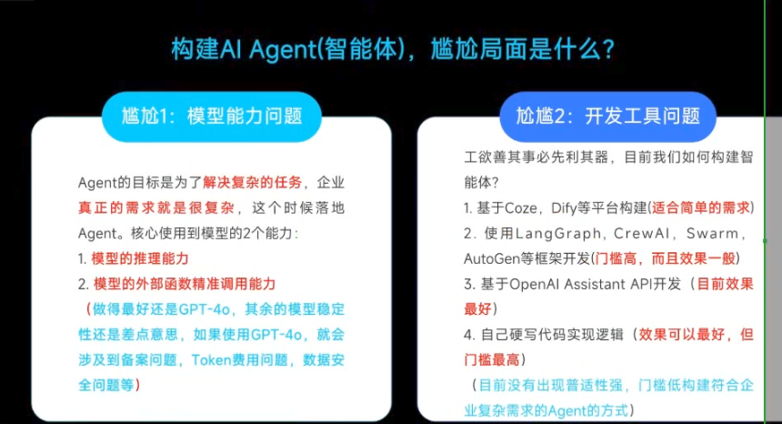
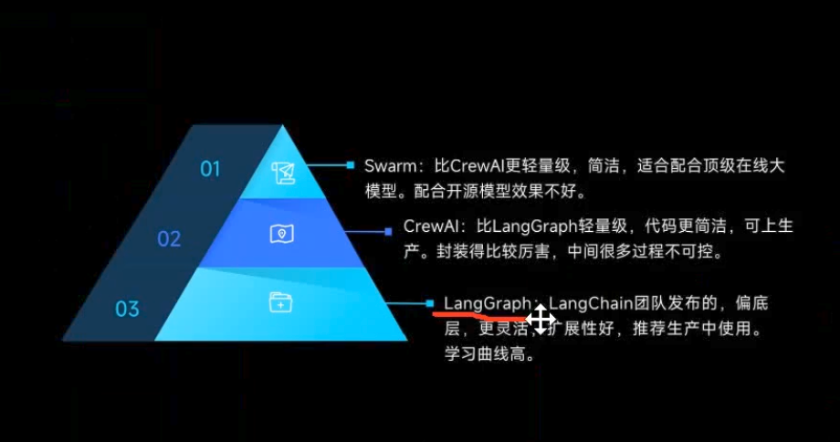

### LangGraph深入剖析与实践
angent不是技术，而是使用**LLM思想**-->先规划再分而治之
1. **planning**对任务进行规划（任务的拆解），是否合理，可能出现幻觉,需要强大的推理能力
2. **action** 执行过程中，需要强大的外部函数调用(tool)能力，
3. **tool**-->调用哪一个
4. **memory**

## ai开发框架哪个好

* langchain：
LangChain 不是给大模型附魔，是给你的程序附魔。 大模型本身不会因为装了它变聪明——变能干的是你写的程序。原来你的程序只会"问一句、答一句"，装上这些工具后，它会记事（记住对话）、会查资料、会把几步串起来做。模型没变，你的程序多了装备。