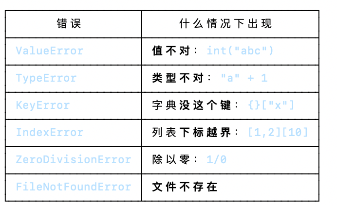
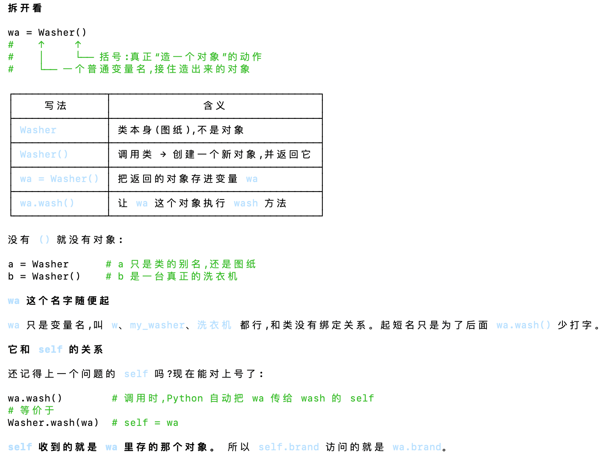
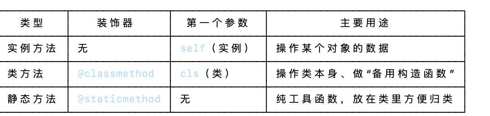
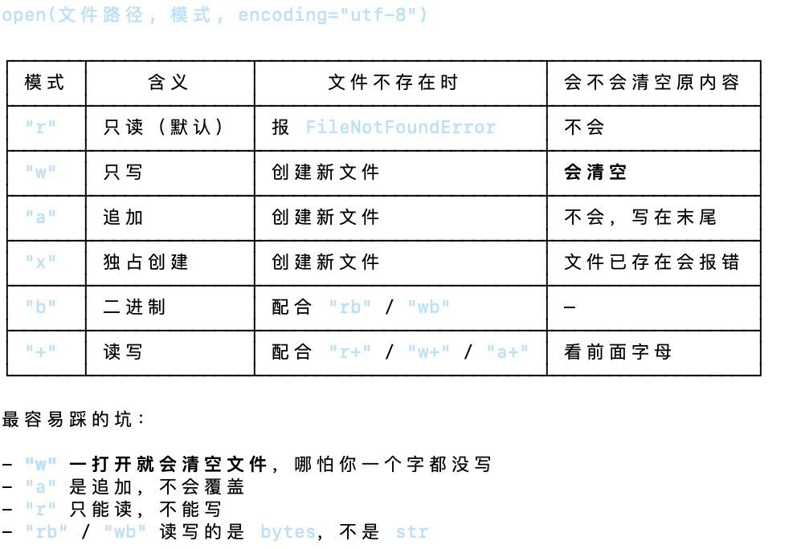

# python3的学习
## 目录
+ []


## 第一章：基础语法
* ### 标识符
1. 第一个字符必须以字母（a-z, A-Z）或下划线 _ 。
2. 标识符的其他的部分由字母、数字和下划线组成。
3. 标识符对大小写敏感，count 和 Count 是不同的标识符。
4. 标识符对长度无硬性限制，但建议保持简洁（一般不超过 20 个字符）
5. 禁止使用保留关键字，如 if、for、class 等不能作为标识符。
   
==eg==. 
```
age = 25                # 普通变量名，最常见
user_name = "Alice"     # 用下划线连接单词，清晰易读
_total = 100            # 下划线开头通常表示“内部使用”或“私有”
MAX_SIZE = 1024         # 全大写通常表示“常量”（固定不变的值）
calculate_area()        # 函数名，动词+名词
StudentInfo             # 类名，首字母大写（驼峰命名法）
__private_var           # 双下划线开头，有特殊含义
```
```
2nd_place = "silver"    # 错误：以数字开头
user-name = "Bob"       # 错误：包含连字符
class = "Math"          # 错误：使用关键字
$price = 9.99          # 错误：包含特殊字符
for = "loop"           # 错误：使用关键字
```
==⚠️==：<u>Python 3 允许使用 Unicode 字符作为标识符，可以用中文作为变量名，非 ASCII 标识符也是允许的了</u>

* ### 保留关键字


[Python 保留关键字参考](https://www.runoob.com/python3/python3-keyword.html)

* ### 注释
1. 单行注释以 # 开头:`print ("Hello, Python!") # 第二个注释`
2. 多行注释可以用多个 # 号，还有 ''' 和 """：
```
第三注释
第四注释
'''
 
"""
第五注释
第六注释
"""
```
* ### 行与缩进
python最具特色的就是使用缩进来表示代码块，不需要使用大括号 {} 。

缩进的空格数是可变的，但是同一个代码块的语句必须包含相同的缩进空格数。空格数不一致，会导致运行错误。==4个空格为一个缩进==

* ### 空行
空行的作用在于分隔两段不同功能或含义的代码，便于日后代码的维护或重构。

* ### print输出
print 默认输出是换行的，如果要实现不换行需要在变量末尾加上 end=" "


* ### import 与 from...import
在 python 用` import `或者 `from...import` 来导入相应的模块[^模块]。

将整个模块(somemodule)导入，格式为： `import somemodule`

从某个模块中导入某个函数,格式为：` from somemodule import somefunction`

从某个模块中导入多个函数,格式为： `from somemodule import firstfunc`, `secondfunc`, `thirdfunc`

将某个模块中的全部函数导入，格式为： `from somemodule import *`

[^模块]: 模块就是一个 `.py` 后缀的 Python 文件，里面写好了变量、函数、类，用来把代码拆分、复用。
一句话：一个`.py`文件 = 一个模块.

* ### 命令行参数
怎么说呢，现在不是很理解这个东西，我对他现在的理解就是我可以从从终端里输入`python3 test.py -n RUNOOB -u www.runoob.com​​​​​`这个东西，然后吧命令参数`RUNOOB`和`www.runoob`交给我的程序`test.py`
对了，命令行参数的内容都被保存在`sys.argv`这个模块中
以后我会回来补充的😘

## 基本数据类型
* Python 中的变量不需要声明。每个变量在使用前都必须赋值，变量赋值以后该变量才会被创建。

在 Python 中，变量就是变量，它没有类型，我们所说的类型是变量所指的内存中对象的类型。

等号 = 用来给变量赋值。等号左边是变量名，右边是存储在变量中的值。
==eg==：
```
#!/usr/bin/python3

counter = 100          # 整型变量
miles   = 1000.0       # 浮点型变量
name    = "runoob"     # 字符串

print(counter)
print(miles)
print(name)
```
* Python 允许你同时为多个变量赋值。
  ==eg==:
  `a = b = c = 1`or`a, b, c = 1, 2, "runoob"`
* 可以通过 `type()` 函数查看变量的类型
  ==like==:
```
print(type(x))         # <class 'int'>
print(type(y))         # <class 'float'>
print(type(name))      # <class 'str'>
print(type(is_active)) # <class 'bool'>
```
### 标准数据类型
Python3 中有 6 种标准数据类型，以及 bool 布尔类型（bool 是 int 的子类，有时单独列出）：

* **Number（数字）**:**int**、**float**、**bool**、**complex（复数）**
**String（字符串）**:Python 中的字符串用单引号 `'` 或双引号 `"` 括起来，同时使用反斜杠 `\` 转义特殊字符。

```
#!/usr/bin/python3

my_str = 'Runoob'       # 定义一个字符串变量（避免使用 str 作为变量名，会覆盖内置类型）

print(my_str)           # 打印整个字符串：Runoob
print(my_str[0:-1])     # 打印索引 0 到倒数第二个字符（不含最后一个）：Runoo
print(my_str[0])        # 打印第一个字符：R
print(my_str[2:5])      # 打印索引 2、3、4 的字符（不含索引 5）：noo
print(my_str[2:])       # 打印从索引 2 开始到末尾：noob
print(my_str * 2)       # 重复打印两次：RunoobRunoob
print(my_str + "TEST")  # 字符串拼接：RunoobTEST
```
***输出***
```
Runoob
Runoo
R
noo
noob
RunoobRunoob
RunoobTEST
```
Python 使用反斜杠 \ 转义特殊字符，如果你不想让反斜杠发生转义，可以在字符串前面添加一个 r，表示原始字符串：
```
>>> print('Ru\noob')
Ru
oob
>>> print(r'Ru\noob')
Ru\noob
```

**bool**（布尔类型）：布尔类型即 True 或 False。在 Python 中，True 和 False 都是关键字，表示布尔值。
**List**（列表）：列表写在方括号 [] 之间，用逗号分隔开的元素列表。
语法格式：变量[头下标:尾下标]


和字符串一样，列表同样可以被索引和截取，列表被截取后返回一个包含所需元素的新列表
**Tuple**（元组）：元组（tuple）与列表类似，不同之处在于元组的元素不能修改。元组写在小括号 () 里，元素之间用逗号隔开。
**Set**（集合）：Python 中的集合（Set）是一种无序、可变的数据类型，用于存储唯一的元素。集合中的元素不会重复，并且可以进行交集、并集、差集等常见的集合操作。

在 Python 中，集合使用大括号 {} 表示，元素之间用逗号 , 分隔。也可以使用 set() 函数创建集合。
==注意==：创建一个空集合必须用 set() 而不是 {}，因为 {} 创建的是一个空字典。


Dictionary（字典）
按是否可变，可以分为以下两类：

不可变数据（4 个）：Number（数字）、String（字符串）、bool（布尔）、Tuple（元组）
可变数据（3 个）：List（列表）、Dictionary（字典）、Set（集合）

bytes 类型表示的是不可变的二进制序列（byte sequence）。与字符串类型不同的是，bytes 类型中的元素是整数值（0 到 255 之间的整数），而不是 Unicode 字符。

**bytes** 类型：
bytes 类型通常用于处理二进制数据，比如图像文件、音频文件、视频文件等。在网络编程中，也经常使用 bytes 类型来传输二进制数据。

创建 bytes 对象最常见的方式是使用 b 前缀：
```
x = b"hello"           # 使用 b 前缀创建 bytes 对象
print(x)               # b'hello'
print(type(x))         # <class 'bytes'>
print(x[0])            # 104（'h' 的 ASCII 值，bytes 元素是整数）
```
### 数据类型的转换
* 隐式类型转换-自动完成：
  对两种不同类型的数据进行运算，较低数据类型（整数）就会转换为较高数据类型（浮点数）以避免数据丢失。但是整型和字符串类型运算结果会报错。
* 显式类型转换-需要使用类型函数来转换
  ==eg==：`y = int(2.8) # y 输出结果为 2`

***
# 头歌实验：
* 补齐空格：`ljust`(左对齐补齐空格)
```
'WHU'.ljust(4)      # 'WHU '   ← 补到 4 个字符宽
'WHUT'.ljust(4)     # 'WHUT'   ← 本来就够 4，原样返回
'PKU'.ljust(4)      # 'PKU '
```
* 必备参数：`def add(a, b):      # ← 你在这里承诺："用我，必须给我两个值"`
* return：return 的作用是"把值送出去"，"结束函数"只是顺带的后果。
* 什么时候真的需要 return

两种情况，一种是送值，一种是提前结束：

① 要把结果交给调用方
```
def add(a, b):
    return a + b       # 调用方要用这个结果

x = add(3, 4)
print(x)               # 7
```
② 要提前溜走，跳过后面的代码

这才是你想的"退出函数"——但注意，只有当后面还有代码需要跳过时，它才有意义：
```
def check(n):
    if n < 0:
        print("负数，不处理")
        return              # ← 提前结束，下面的代码全部跳过
    print("继续处理")
    print("处理完毕")

check(-1)    # 只打印"负数，不处理"
check(5)     # 打印"继续处理"、"处理完毕"
```
对比一下，return 在末尾和在中途的区别：
```
def f():
    print("A")
    return              # 提前溜
    print("B")          # 永远执行不到

f()      # 只打印 A
```
return 写在最后一行 = 废话；写在中间 = 真的在"退出函数"。
* 变量输出：首先，我们先来分清“**格式化**”和"**输出**"：
  - f"..."、"%s" % x、"{}".format(x) → 都是造出一个新字符串，跟 print 没关系
  - print() → 才是把东西显示到屏幕上
  有五种写法：
```
name = "李明"
age = 18

print(name, age)                        # ① print 多参数
print(name + " " + str(age))            # ② 字符串拼接
print("%s %d" % (name, age))            # ③ % 格式化
print("{} {}".format(name, age))        # ④ str.format()
print(f"{name} {age}")                  # ⑤ f-string ← 推荐
```
逐个说：
```

① print 多参数——最简单

print(name, age)              # 李明 18
print("a", "b", "c")          # a b c

逗号分隔，自动加空格。什么都不用管，print 会自动把每个值转成字符串。缺点是格式控制不了（只能空格分隔）。

② + 拼接——类型必须全是字符串

print("你好，" + name + "！")     # 你好，李明！
print("年龄：" + age)             # ✗ TypeError!
print("年龄：" + str(age))        # ✓ 得手动转

+ 对字符串是拼接、对数字是加法，两者不能混。所以数字必须 str() 转一下——很啰嗦，值多了更啰嗦。

③ % 格式化——C 的老朋友

这个你已经会了，就是 C 的 printf：

printf("%s 今年 %d 岁\n", name, age);

print("%s 今年 %d 岁" % (name, age))

常用格式符跟 C 一模一样（我验证过）：

print("%s|%d|%f|%.2f|%5d|%-5d|" % ("abc", 42, 3.14159, 3.14159, 42, 42))
# abc|42|3.141590|3.14|   42|42   |
print("%x  %o  %e" % (255, 8, 1234.5))
# ff  10  1.234500e+03
```
==注意==： 多个值要用元组包起来。 一个值时圆括号可省，两个以上必须加：
```
print("%s" % name)              # ✓ 一个值，可以省
print("%s %d" % (name, age))    # ✓ 两个值，必须加圆括号
print("%s %d" % name, age)      # ✗ 这是陷阱！会报错
```
```
④ str.format()——过渡方案

print("{} {}".format(name, age))                    # 按位置
print("{0} {1} {0}".format("A", "B"))               # 按编号，可以重复用 → A B A
print("{name} 今年 {age} 岁".format(name="李明", age=18))   # 按名字
print("|{:^10}|".format("中"))                       # |    中     |

{} 是占位符。你之前写盒子用的 '{:^22}' 就是它——冒号后面是格式控制（宽度、对齐、精度）。现在见到老朋友了。

⑤ f-string——现在的标准，推荐

字符串前面加个 f，{} 里直接写变量名甚至表达式：

a, b = 8, 9
print(f"{a} + {b} = {a + b}")       # 8 + 9 = 17   ← 表达式直接写在里面
print(f"{name} 明年 {age + 1} 岁")    # 李明 明年 19 岁
print(f"{3.14159:.2f}")             # 3.14
print(f"|{name:>6}|{name:<6}|{name:^6}|")
# |    李明|李明    |  李明  |

额外的调试小技巧（Python 3.8+）：
print(f"{3.14159 * 2 = }")      # 3.14159 * 2 = 6.28318
在 = 号后面加个空格，它会把表达式原文也一起打出来。调试时不用再手写 "a+b=" 这种标签，非常省事。
```
* print:
```
print("a", "b", "c")                    # a b c        默认用空格分隔
print("a", "b", "c", sep="")            # abc          改分隔符
print("a", "b", "c", sep=" -> ")        # a -> b -> c
print("a", end="")                      # 不换行
print("a", end="\n\n")                  # 换两行
```

* 嵌套函数：
  拆解：从里往外读
  
* 亲眼看看 eval 到底有多"万能"
```
print(eval("2 + 3"))              # 5
print(eval("'你好' * 3"))          # 你好你好你好   ← 连字符串运算都行
print(eval("[1, 2, 3][0]"))       # 1             ← 连索引都行
```
普通字符串：一张纸条，上面写着算式，只给你看文字
eval（把字符串当代码执行）：叫 Python读纸条上的内容，直接算出答案，`input()*10        # 这本身就是一段合法的 Python 代码`

* `input`只执行字符串 
* if语法：
  - 冒号 : = 宣告"下面是一个代码块"
  - 缩进 = 标记"这几行属于这个代码块"，缩进的规矩：统一用 4 个空格
* 格式说明符里不能写变量名

关键认识：冒号后面那段是「格式语言」，不是 Python 表达式。

你在里面写 choice，Python 不会去查这个变量的值，而是把它当成格式指令去解析。choice num 不是合法的格式指令 → 报错。


* 「截取」and「四舍五入」

`.4f` 这种写法是四舍五入,字符串切片天生就是"截取"

* 嵌套引号

* ***random模块用法***
导入
```
import random
random.randint(1, 6)              # 每次都要写 random. 前缀

from random import randint, choice
randint(1, 6)                    # 直接叫名字（但容易跟别的名字撞） 
```
常用函数一览


实测效果（我跑出来的真实输出）：
```
random.randint(1, 6)              # 6, 1, 1, 6, 3, 2, 2, 2, 6, 1
random.random()                  # 0.6394, 0.025, 0.275, 0.2232, 0.7365
random.choice(["苹果","香蕉","橘子","葡萄"])   # 苹果
random.choices(..., k=3)         # ['苹果', '香蕉', '苹果']   ← 苹果出现两次
random.sample(..., k=2)          # ['苹果', '橘子']           ← 不会重复
```
==坑点==：
shuffle 原地改，返回 None
```
lst = [1, 2, 3, 4, 5]
lst2 = random.shuffle(lst)      # ✗ lst2 是 None！lst 被改了

lst = [1, 2, 3, 4, 5]
random.shuffle(lst)             # ✓ 直接改 lst 本身
print(lst)                      # [4, 2, 3, 1, 5]
```
seed 有什么用:
```
random.seed(1)
print(random.randint(1, 100))    # 18
random.seed(1)
print(random.randint(1, 100))    # 18  ← 一模一样！
```
不设种子时，Python 拿系统时间当种子，所以每次跑结果都不同。设了种子，同一串随机数就能反复重现。**相当于固定了翻书起点**，数字组合会变，但是产生这个组合的方式不变。
三个实际用途：

1. 调试 —— 程序在某个随机情况下出错，固定种子就能每次都重现那个 bug，否则你根本抓不住
2. 出题/判题 —— 头歌这类平台的"随机"测试数据必须可复现，否则没法判分
3. 做实验 —— 对比两种算法时，要让它们面对同一批随机数据才公平
   
* **字符串，列表，元组，字典**
  
  键（key）和值（value）
{"键": 值} 是JSON 格式，Python 里对应的叫字典 dict，整体是一对一对的映射关系：
 **键（key）**：索引、名字，用来查找
  - 一般是字符串（要用引号包起来），也可以是数字
  - 同一个字典里键不能重复，重复会被覆盖
  - 作用：你通过键去找对应的数据
**值（value）**：真正存的数据
  - 可以是：文字、数字、true/false、数组[]，甚至另一个{}对象
  - 值可以重复，没有限制
  

***第一条分界线（最重要）***：能不能改
不可变：字符串   元组        ← 造出来就冻住了
可变  ：列表     字典        ← 可以增删改
***第二条分界线***：靠什么取元素
靠位置（下标）：字符串  列表  元组     ← 第 0 个、第 1 个……
靠名字（键）  ：字典                   ← d["age"]
1.字符串 str:处理文字、用户输入、文件内容。


2.列表 list:你最常用到的:有序、可变、什么都能装。 就是"C 里那个你得自己 malloc 的动态数组"。
```
scores = [85, 92, 78]

scores.append(90)      # 尾部加一个
scores.insert(0, 100)  # 在指定位置插入
scores[0] = 99         # 改
scores.remove(78)      # 按【值】删
del scores[1]          # 按【下标】删
last = scores.pop()    # 弹出最后一个，并把它返回给你

len(scores)            # 有几个
92 in scores           # 在不在里面
for x in scores:       # 遍历
    print(x)
```
3.元组 tuple——列表的"冻结版":数据天生就不该被改时：

坐标   = (3, 4)
RGB颜色 = (255, 128, 0)
日期   = (2026, 10, 8)
**元组的隐藏技能：解包**
```
name, age = ("张三", 19)      # 一次拆成两个变量
print(name, age)              # 张三 19

a, b = 1, 2
a, b = b, a                   # ★ 交换两个变量，一行搞定！

a, b = b, a 这行，C 里你得这么写：

int tmp = a;
a = b;
b = tmp;          // 三行，还得起个临时变量名
```
顺带：a = 1, 2 其实就是在造元组（括号可以省）。赋值号右边有逗号，就是元组。
4.字典 dict——用"名字"查东西
```
student = {"name": "张三", "age": 19, "city": "武汉"}

student["name"]          # '张三'    ← 用键取，不是下标
student["age"]           # 19
student["score"] = 95    # 加一个新键值对
del student["city"]      # 删
"name" in student        # True     ← 查的是【键】在不在
len(student)             # 有几个键值对

[] 和 get() 的区别（重要）

student["zzz"]              # ✗ KeyError：键不存在直接报错
student.get("zzz")          # None：不存在返回 None，不报错
student.get("zzz", 0)       # 0：不存在就返回你指定的默认值
```
拿不准键在不在时，用 get()。
```
student["zzz"]              # ✗ KeyError：键不存在直接报错
student.get("zzz")          # None：不存在返回 None，不报错
student.get("zzz", 0)       # 0：不存在就返回你指定的默认值
```
**互换**：
```
list("abc")              # ['a', 'b', 'c']     字符串 → 列表
"".join(["a", "b"])      # 'ab'                列表 → 字符串
tuple([1, 2])            # (1, 2)              列表 → 元组
list((1, 2))             # [1, 2]              元组 → 列表
dict([("a", 1)])         # {'a': 1}            键值对列表 → 字典
list(d)                  # ['a', 'c']          字典 → 列表（拿到的是键）
list(d.items())          # [('a', 99), ...]    字典 → 键值对列表
```
* **输入输出列表，元组，字典**
  * 输出
  
  列表
```
lst = [1, 2, 3]

print(lst)                    # [1, 2, 3]        ← 带方括号，一般 OJ 不要这个
print(*lst)                   # 1 2 3            ← ★ 最常用
print(*lst, sep=", ")         # 1, 2, 3          ← 自定义分隔符
print(" ".join(map(str, lst))) # 1 2 3           ← 另一种写法

print(lst) 和 print(*lst) 的区别，是列表输出最关键的一点：

print(lst)   →  [1, 2, 3]     整个列表当一个东西打印，带方括号
print(*lst)  →  1 2 3         把元素一个个拆出来打印

大部分 OJ 题目要的是后者。
```
元组
```
t = (1, 2, 3)
print(t)         # (1, 2, 3)    带圆括号
print(*t)        # 1 2 3        ← 同样用 * 拆开
```
字典（有个坑）
```
d = {"a": 1, "b": 2}

print(d)         # {'a': 1, 'b': 2}    ← 带花括号和引号
print(*d)        # a b                 ← ⚠️ 只拿到【键】，值丢了！

print(*d) 只解出键，因为遍历字典默认就是遍历键。要输出键值对得自己写：

for k, v in d.items():
    print(k, v)              # a 1
                             # b 2

# 或者挤在一行
print(*[f"{k}:{v}" for k, v in d.items()], sep=", ")    # a:1, b:2
```
 ` *`**到底是什么**
你之前学 `*args` 时见过它——* 的作用是"把容器拆开"：
```
print(*[1, 2, 3])        # 完全等于 print(1, 2, 3)
print(*"abc")            # 完全等于 print("a", "b", "c")   → a b c
```
这就解释了为什么它能去掉方括号——因为列表被拆成了三个独立的参数，print 就按"多个参数"来对待了（用 sep 分隔）。

顺带一提，sep 会作用于所有参数之间，包括你写的文字：

`print("前缀", *lst, sep=", ")     # 前缀, 1, 2, 3    ← "前缀"后面也有分隔符`

输入
先背下这一行`nums = list(map(int, input().split()))`
```
input()                →  "1 2 3 4 5"              一整行文本
.split()               →  ["1","2","3","4","5"]    按空格切成列表（但都是字符串！）
map(int, ...)          →   把每个元素都交给 int 转一遍
list(...)              →  [1, 2, 3, 4, 5]          变成真正的整数列表
```

* **集合set（无序、不重复的容器）:**
1. 怎么创建：
 ```
s = {1, 2, 3}                # 花括号
s = set([1, 2, 2, 3, 3])     # 从别的容器造 → {1, 2, 3}
s = set("hello")             # 从字符串造 → {'h','e','l','o'}
s = set()                    # 空集合
```
2. 坑点：
```
type({})        # dict    ← 空字典！
type(set())     # set     ← 空集合只能这么写
```
3. 两个核心特性：
```
① 不重复——自动去重

{1, 2, 2, 3, 3, 3}       # {1, 2, 3}

② 无序——不能下标取值

s = {3, 1, 2}
s[0]        # ✗ TypeError: 'set' object is not subscriptable

所以集合不能"取第几个"，只能判断"在不在"、遍历、做运算。
```
4. 常用操作：
```
s = {1, 2, 3}

s.add(4)          # 加一个
s.remove(1)       # 删一个 —— 不存在会报 KeyError
s.discard(99)     # 删一个 —— 不存在【不报错】（更安全，推荐）

4 in s            # 在不在 → True
len(s)            # 有几个元素

for x in s:       # 可以遍历
    print(x)

remove 和 discard 的区别：不确定元素在不在时，用 discard。
```
5. 集合的运算：
```
a = {1, 2, 3, 4}
b = {3, 4, 5, 6}

a | b      # {1,2,3,4,5,6}   并集：两个合起来
a & b      # {3, 4}          交集：两个都有
a - b      # {1, 2}          差集：a 有但 b 没有
a ^ b      # {1,2,5,6}       对称差：只在一个里有的
```
6. 什么时候用：
```
① 去重（最常用）

lst = [1, 2, 2, 3, 3, 3]
去重后 = list(set(lst))          # [1, 2, 3]

⚠️ 顺序会乱（因为集合无序）。要保持原来的顺序：

保持顺序 = list(dict.fromkeys(lst))    # [1, 2, 3]

（这里借用了字典"键不重复 + 保持插入顺序"的特性。）

② 快速判断"在不在"

集合查元素比列表快得多——列表是"从头一个个比过去"，集合是"算个数字直接跳过去"。数据量大的时候差距是几十上百倍。

③ 求"共同/独有的东西"

就是上面那个选课的例子。
```
  

* **循环语法**
  1.python中的for时遍历而非计数，C里的是计数循环
  
  Python 的 for 后面跟的不是条件，是一个「容器」：
```
for x in [10, 20, 30]:      # 把列表里的元素一个个拿出来，每次叫它 x
for ch in "abc":            # 把字符串的字符一个个拿出来
for k in {"a": 1, "b": 2}:  # 把字典的键一个个拿出来
```

2.如果要计数的话，造一个数字序列去遍历它。
`range()` 不是"计数器"，它造出一串数字让你去遍历：
```
for i in range(10):
    print(i)          # 0 1 2 3 4 5 6 7 8 9

range() 的全部规则（实测）：

list(range(5))          # [0, 1, 2, 3, 4]        从0开始，不含5
list(range(1, 5))       # [1, 2, 3, 4]           含头不含尾
list(range(1, 10, 2))   # [1, 3, 5, 7, 9]        第三个参数是步长
list(range(10, 0, -1))  # [10, 9, ..., 1]        倒着数
list(range(5, 0))       # []                     ⚠️ 空的！
```
`range(5, 0)` 那个坑要记牢：往回数必须写负步长，`range(10, 0, -1)` 才对。忘了写 -1 就得到空序列，for 一次都不执行，程序静悄悄地什么都不干。

▎ 含头不含尾这个规则你已经在切片里见过（s[1:4]）——range 和切片用的是同一套规则，Python 里凡是"范围"都这样。

for 的循环变量是每次都重新赋值的：
```
for i in range(3):
    print(i)
print(i)          # 2   ← 循环结束后 i 还在，值是最后一个
```
（这点和 C 一样。）
3.for 能遍历什么
```
for x in [1, 2, 3]:              # 列表
for ch in "abc":                 # 字符串（一个个字符）
for x in (1, 2, 3):              # 元组
for k in d:                      # 字典 → 拿到【键】
for k, v in d.items():           # 字典 → 同时拿键和值
for line in open("a.txt"):       # 文件 → 一行行读
for i in range(5):               # 数字序列
```
`for _ in range(n)` 里的下划线是惯例："这个变量我用不上，占个位"。你在 OJ 代码里见过很多次了。
4.while（先判断后执行）:什么时候用 while 而不是 for？
▎ - 知道要跑多少次 → for
▎ - 不知道跑多少次，只知道"到某个条件就停" → while
比如"一直读输入直到读到 0 为止"，就该用 while。
5.for...else：Python 特有的
```
for x in [1, 2, 3]:
    if x == 5:
        print("找到了")
        break
else:
    print("循环正常跑完，没被 break 打断")

else 在循环"正常跑完"时执行；如果中途 break 了就不执行。

这个设计专门用来表达**"找遍了都没找到"**：

for student in students:
    if student["name"] == "张三":
        print("找到了")
        break
else:
    print("名单里没有张三")     # ← 一个都没匹配上才走这里
```
6.两个好搭档：enumerate 和 zip
enumerate：既要下标又要值
```
C 的 for 天生带下标 i，Python 的 for 不带——所以需要下标时用 enumerate：

// C：下标是自带的
for (int i = 0; i < n; i++) {
    printf("%d %s\n", i, names[i]);
}

# Python：用 enumerate 把下标也一起拿出来
for i, name in enumerate(names):
    print(i, name)

for i, name in enumerate(["苹果", "香蕉", "橘子"]):
    print(f"{i}: {name}")
# 0: 苹果
# 1: 香蕉
# 2: 橘子

enumerate(names, start=1)      # 想从 1 开始数，加这个参数
```
zip：同时遍历多个序列
```
names = ["张三", "李四", "王五"]
scores = [85, 92, 78]

for n, s in zip(names, scores):
    print(n, s)
# 张三 85
# 李四 92
# 王五 78
```
C 里你得用同一下标 i 去访问两个数组，Python 直接 zip 起来。哪个短就以哪个为准，多出来的忽略。
7.一个必踩的坑：
```
lst = [1, 2, 4, 6, 5]
for x in lst:
    if x % 2 == 0:
        lst.remove(x)
print(lst)      # [1, 4, 5]   ← 4 被跳过了！
```
原因：for 是按位置依次取元素的。你一边删元素，列表一边变短，后面的元素整体往前挪——而 for 的下标还在往前走，于是刚挪过来的那个元素被跳过了。
正确做法：造一个新列表，别改原来的。
```
lst = [1, 2, 4, 6, 5]
lst = [x for x in lst if x % 2 != 0]     # 列表推导式
print(lst)      # [1, 5]
```
▎ 规矩：遍历时不要增删容器元素。 要筛选用"造新列表"，非要原地删就倒着遍历（reversed）或者用 while 手动控制下标。
▎
▎ 注意：改元素的值是安全的（lst[i] = 99 没问题），危险的是增删（改变长度）。
8.列表推导式` [x for x in lst if x % 2 != 0]`:
把满足条件的元素收集成新列表
```
[x * 2 for x in [1, 2, 3]]              # [2, 4, 6]      对每个元素做变换
[x for x in [1, 2, 3, 4] if x % 2 == 0] # [2, 4]         筛选
[x          for x in lst        if x % 2 != 0]
  ↑  取出x    ↑遍历lst中每个元素x   ↑条件：x除以2余数≠0，就是奇数
[x * 2 for x in [1, 2, 3, 4] if x > 1]  # [4, 6]         两者结合
```
相当于`for 循环 + append`
```
result = []
for x in [1, 2, 3]:
    result.append(x * 2)

result = [x * 2 for x in [1, 2, 3]]
```
* Python 规定：所有系统自带的特殊变量 / 方法，都用`__xxx__格`式。这些又叫python里的魔法变量。
  1.` __name__`（你刚学的，最重要）
作用：告诉你当前模块是以什么方式被加载的
直接运行这个文件：`__name__ == "__main__"`
被别的文件import导入：`__name__ == 文件名`
用途：用来写`if __name__ == '__main__':`，分离函数定义 和 测试代码。
函数写上面，测试代码放进 if 里面；导入模块时不会自动跑测试。
2. `__doc__` 文档字符串
就是函数 / 类下面用三引号写的说明文字。
```
python
def cube(length, width, height):
    """计算长方体的表面积和体积"""
    s = (length*width+length*height+width*height)*2
    v = length*width*height
    return s,v

print(cube.__doc__)
输出：计算长方体的表面积和体积
用途：查看函数说明，做文档。
```
3. `__file__`
保存当前 py 文件的路径（在本地电脑有效，在线平台不一定支持）
```
python
print(__file__)
```
4. 类里面的` __init__`（魔法方法，不是变量，但是长得一样）
```
python
class Box:
    def __init__(self,l,w,h):
        self.l = l
```
`__init__`：创建对象的时候自动执行，用来初始化对象属性。
其他常见魔法（后面学习会遇到）
`__str__`：打印对象的时候，控制输出什么文字
`__len__`：调用len(对象)时自动执行
✅ 重点区分：魔法变量 vs 普通变量
普通变量：存业务数据，比如长宽、面积、a=3
魔法变量：存代码本身的信息（文件名字、模块信息、文档说明），描述代码自身。
⚠️ 重要提醒
不要自己随便创建 `__xxx__ `名字，属于系统预留，容易冲突。自己写变量只用普通名字，比如length、volume。
魔法变量不用你手动赋值，Python 自动帮你生成。你只负责读取。
简单总结
普通变量 = 存计算的数据（长宽、面积）
`__xxx__`魔法变量 = 存代码自己的信息（文件、模块、文档）
"魔法"的意思是不用动手调用，python在特定时机自动调用他 
* **try/except：**
解决的是一个很实际的问题：程别一出就死掉。
1. 先看没有它会怎样：
```
age = int(input("你的年龄："))
print("继续执行")

用户输入 abc：

ValueError: invalid literal for int() with base 10: 'abc'
```
 程序当场死了，`print `那行一行都不执行。 用户看到一堆红色报错，什么也干不了。
 2. 基本语法：
```
try:
    可能出错的代码
except 错误类型:
    出错之后怎么办

try:
    age = int(input("你的年龄："))
    print(f"你今年 {age} 岁")
except ValueError:
    print("输入的不是整数")
```
流程：Python 去跑 try 里的代码 → 一切正常就走完了；中途出错 → 立刻跳到 except，try 里剩下的代码不执行。
3. 完整结构：
```
try:
    n = int(input("数字："))
except ValueError:
    print("不是数字")
else:
    print("成功了，n =", n)       # 没出错才执行
finally:
    print("无论如何都执行")        # 出事没出事都执行

┌─────────┬────────────────────┐
│   块    │    什么时候执行    │
├─────────┼────────────────────┤
│ try     │ 总是（要试的代码） │
├─────────┼────────────────────┤
│ except  │ 出错时             │
├─────────┼────────────────────┤
│ else    │ 没出错时           │
├─────────┼────────────────────┤
│ finally │ 无论如何都执行     │
└─────────┴────────────────────┘

平时只用 try + except 就够了，else 和 finally 知道有这么回事即可。
```
4. 常用的错误类型：

5. 三条规矩：
```
① 别写光秃秃的 except:

try:
    ...
except:              # ✗ 什么都抓，连你自己的拼写错误都吞掉
    pass

这是最坏的习惯。 它会把真实 bug 藏起来——程序看起来在跑，实际上什么都没干，你查半天查不出来。

至少写成 except Exception:，它不会抓走 Ctrl+C（KeyboardInterrupt），比裸 except: 安全。

② 尽量指明具体类型

except ValueError:       # ✓ 只抓这一类
except Exception:        # 次选
except:                  # ✗ 别这么写

③ except 里别只写 pass

except ValueError:
    pass                 # ✗ 出错了但你什么都不说

至少告诉用户出错了。pass 只用在"我确实要故意忽略"的少见场合。
```
6. 经典用法：
```
这是你最常用到的模式，背下来：

while True:
    try:
        age = int(input("请输入年龄："))
        break                    # 成功了才跳出循环
    except ValueError:
        print("你输入的不是整数，请重试")
```
流程：一直问 → 用户输入合法数字就 break 出去 → 不合法就提示重试。

这解决了你之前反复踩的那个坑：用户输入乱七八糟的东西，程序不再崩溃。
7. 什么时候该用、什么时候不该用:
- 用户输入（上面那个）
- 读文件（文件可能不存在）
- 网络请求（可能超时）
- 格式转换（数据可能不合预期）

❌ 不该用来掩盖自己的 bug

try:
    复杂的一段逻辑
except Exception:
    print("出错了")

这种写法很危险：它把你代码里的真实错误也一起吞了。你写错的变量名、用错的方法，全都会被伪装成"出错了"，然后你永远查不出来。

判断标准一句话：

▎ try/except 是给"我控制不了的意外"用的，不是给"我没写对"用的。
* **切字符：**
1. 按分隔符切：split（）最常用
```
s = "a,b,c,123"
res = s.split(",")  # 用逗号切开，返回列表
print(res)
# ['a', 'b', 'c', '123']
split() 不带参数：按任意空白（空格 / 换行 /tab）切割，自动忽略连续空格
```
split(sep,maxsplit)限制切几次
```
s = "one two three four"
print(s.split(" ", maxsplit=2)) # 只切前2次：['one', 'two', 'three four']
```
2. 从右切：rsplit():
```
s = "one two three four"
print(s.split(" ", maxsplit=2)) # 只切前2次：['one', 'two', 'three four']
```
3. 按行切splitlines()：
把多行字符串按换行\n切开
```
txt = "第一行\n第二行\n第三行"
print(txt.splitlines())
```
4. 切片截取（按位置去一段字符，不是分割成列表）：
格式：字符串[起始：结束：步长]：左开右闭，结束下标不取
```
s = "abcdef"
print(s[1:4])  # 下标1到3：bcd
print(s[:3])   # 从头到下标2：abc
print(s[2:])   # 下标2到末尾：cdef
print(s[::2])  # 步长2，隔一个取一个：ace
print(s[::-1]) # 字符串反转：fedcba
```
5. 取单个字符下标：
```
s = "abcdef"
print(s[1:4])  # 下标1到3：bcd
print(s[:3])   # 从头到下标2：abc
print(s[2:])   # 下标2到末尾：cdef
print(s[::2])  # 步长2，隔一个取一个：ace
print(s[::-1]) # 字符串反转：fedcba
```
6. 区分：split：按符号切成多个字符串，得到列表（拆分句子）
[a:b]：按位置截取一段子串（抠一段文字）
* `from math import *`:*代表全部东西,直接写 pi、sin、log！
* 第 1 个 if 成立，打印沪市 A 股
后面所有 if 都不成立，最后一个 if 不成立，触发它的 else，额外打印：错误编码
👉 结果会输出两行
* 文件读写
---
# 哔哩哔哩课程
## 基础
内存就相当于是仓库，赋值时变量就相当于c语言中的指针，只保存了对象的地址（对象存在于仓库中）。
* 赋值和深浅拷贝
* 函数与return
1. return返回值（若超过1个值，则返回元组）给调用者
2. return表示函数结束
* return与print：
* 形参与实参：定义函数时里里面的值，实参调用函数时里面的具体的值
* 必备参数：传递和定义参数的顺序集个数必须一致，def（a，b），写了几个要传几个
* 默认参数：为参数提供默认值，调用函数时可以不传该默认值的值，fanc（a = 8），⚠️所有位置参数必须出现在默认参数前，包括函数定义和调用（b，a = 8）
* 可变参数：传入值得数量可以改变，可以传入多个，也可以不传，，def func(*args),以元组形式返回
* 关键字参数：def fund(**kwargs)，以字典形式返回{a = 1,b = 2},key = value,可以扩展函数的功能
* 函数嵌套：在一个函数中调用另一个函数
* 作用域：指的是变量生效范围，有局部变量和全局变量
全局变量：函数外部定义的变量，在整个文件中都有效，局部变量反之，函数结束时失效
global全局变量，将局部变量变成全局变量
* 匿名函数：函数名 = lambda（关键字） 形参；返回值（表达式），无需return返回值，表达式本身就是返回。add = lambda a,b：a+b
* lambda的参数形式：无参，一个，默认
* lambda结合if判断：comp = lambda a,b:"a>b"if a>b else "a<=b>"
* 内置函数：
  1. 查看所有内置函数import builtins-->print(dir(builtins))
  2. 常用内置函数
   - `abs()`：返回绝对值
   - `sum()`：求和，里面只能是可迭代对象
   - `min()`：求最小值
   - `max()`：求最大值
   - `zip()`：将可迭代对象中对应的元素打包成元组

     ```python
     li = [1, 2, 3]
     li2 = ['a', 'b', 'c']
     print(zip(li, li2))
     for i in zip(li, li2):
         print(i)
         print(type(i))
     ```

     输出：

     ```text
     <zip object at 0x...>
     (1, 'a')
     <class 'tuple'>
     ...
     ```
   - map():可以对可迭代对象中的每一个元素进行映射，分别去执行，简单来说就是将每一个元素都遍历一遍
     ```
     li = [1,2,3]
     def funa(x):
         return x * 2
     print(list(map(funa, li)))#[2, 4, 6]
     ```
   - reduce():先把对象中的两个元素去除，计算出其中一个值然后保存着，接下来把这个计算值跟第三个元素进行计算，需要先导包
    ```
    from functools import reduce
    # reduce(function, sequence)函数会对参数序列中元素进行累积,function必须接收两个参数,sequence是序列：可迭代对象。
    li = [1,2,3,4]
    def funb(x,y):
        return x + y
    print(reduce(funb, li))  # 10
    ```
* 拆包：对于函数中的多个返回数据，去掉元组，列或者字典直接获取里面数据的过程。
```
tua = (1,2,3,4)
print(tua)
# print(tua[0])
# a,b,c,d = tua
# print(a,b,c,d)#method1
a,*b = tua
print(a,b) #method2
```
* 异常：
  - 抛出异常raise：
  - try and except:用来捕获代码运行时的错误，不让程序直接崩溃终止。1. 先运行 `try` 里面所有代码;
   ✅ 如果**没有报错**：`except` 里面代码**不执行**，直接跳过; ❌ 如果**出现异常**：立刻停止 try 里代码，跳到`except`执行
    ```
    def login():
        pwd = input("请输入密码：") 
        if len(pwd) >= 6:
            return '登录成功'
        raise Exception("密码长度不能小于6位")
    # print(login())
    try: #捕获异常
        print(login())
    except Exception as e:
        print(e) #捕获异常是为了防止程序崩溃，打印异常信息，让程序继续执行下去
    ```
* > 模块：一个py文件就是一个模快，即倒入一个模块本质上就是执行一个py文件
  > 1. 内置模块：例如random,time,os,login,直接导入皆可使用
  > 1. 第三方模块：下载：终端输入pip install 模块名（pip install 是 Python 的“安装包”命令。）
  >1. 自定义模块：自己在项目里定义的模块。注意啊；命名要遵循规则。不要与内置模块起冲突，否则会导致模块功能无法使用
  >> 导入模块：
  >> import 模块名
  >> 调用模块功能：模块.功能名
    ```
        #方式一：import 模块名；注意一个import可以导入多个模块，但最好一个模块单独使用一个import
        # import pytext
        # #调用pytext中的name变量
        # print(pytext.name)
        # #调用pytext模块中的funa函数
        # pytext.funa()
        #方式二：from ...import...
        #语法：from 模块名 import 功能1，功能2...;从模块中导入指定的功能
        from pytext import funa
        funa() #直接输入功能即可，不用再添加模块了
        #方式三：from ... import *(代表所有）#不建议过多使用from ... import ，有时候命名冲突会导致出现一些错误
     ```
  >> 给模块起别名：import 模块 as 别名
  >> 给功能起别名：from 模块名 from 功能名 as 别名，另一个功能名 as 别名（多个功能用逗号隔开）
* 内置全局量：`__name__`:用于控制py文件在不同场景执行不同的逻辑
  -` if __name__  =="__mian__"`:文件在当前程序执行（）自己执行自己,被当作模块导入是，下面的内容不会被显示
  - `__name__== 模块名`:文件被当作模块被其他文件导入
    ```
    import pytext2
    pytext2.text()
    ###
    print("这是pytext2作为模块会显示的内容")
    def text():
        print("哈哈哈")
    if __name__ == "__main__":
        print("这是pytext2作为模块不会显示的内容")
    ###
    ```
* 包：就是项目结构中的文件夹/目录
  - 与普通文件夹的区别：包是含有`__init__.py`的文件夹（不建议在`__init__.py`文件中写大量代码）
  - 作用：联系的模块放到同一文件夹下,有效避免模块名冲突问题，任结构更清晰
  - 新建包：右键项目名-->new-->python package建有联系的模块放到同一文件夹下，有效避免模块名冲突问题，任结构更清晰
  ```
  #导包方式一：
    # import pack_01 #import导入包是首先会执行__init__.py文件
    #这是在模块里__init__.py文件
    # #导包方式二：
    # from pack_01 import register
    # register.reg()
  ```
    ```
    print("这是register.py文件")
    def reg():
        print("nb")
    ###
    这是在模块里__init__.py文件
    这是register.py文件
    nb
    ###
    ```
   - `__all__`:本质上是一个列表，列表里的元素就代表要导入的模块
   > 1. 作用：可以控制要引入的东西
   ```
   register.py
    print("这是register.py文件")
    def reg():
        print("nb")
        
    logon.py
    print("这是一个登录文件")
    def logon():
        print("666")

    __init__.py
    __all__ = ["register",'logon']#相当于导入[]中的模块

    pytext.py
    from pack_01 import *
    register.reg()
    logon.logon()
    ###
    这是register.py文件
    这是一个登录文件
    nb
    666
    ###
   ```
   - 包的本质依旧是模块，包又可以含包
* 递归函数：一个函数在函数内部不掉用其他函数，而是调用自己
  > 条件：
  > 必须有一个明确的结束条件 --递归出口
  > 每进行更深一层的递归，问题规模相比上次递归要有所减少 
  >相邻两次重复之间有紧密联系
  > 很简洁，逻辑清晰；使用递归函数时，消耗内存，慢
* 闭包：在嵌套函数的前提下，内部函数使用了外部函数的变量，而且外部函数返回了内部函数，我们把使用了外部函数的内部函数称为闭包
> 条件：
> 1. 函数嵌套（函数里面再定义函数）
> 2. 内层呢函数使用外层函数的局部变量
> 3. 外层函数返回值是内层函数的函数名
```
def out():#外层函数
    n =10#外层函数的局部变量
    def inner(): #内层函数
        print(n)#内层函数使用外层函数局部变量
    return inner#返回内层函数名
print(out())#<function out.<locals>.inner at 0x10eb4ee50>,返回的是内部函数的内层函数
# out()()#第一种调用写法
#第二种调用方法
ot=out()
ot()
```
```
def out(m):#外函数，m是形参，也是外函数的局部变量
    n = 10
    def inner():#内函数
        print("计算结果为：",m+n)
    return inner
ot = out(20)#调用外函数
ot()#调用内函数
```
> 函数引用：先思考一下，我们在函数里用到a = 1时，我们知道a这个变量只是存（我们也可以说是引用）了1这个对象的地址，并不是等于a，所以得def add（），中的add这个函数名我们其实可以说里面存了函数的地址，所以我们可以通过引用调用函数
```
def outer(x):
    def inner(y):
        return x + y      # x 来自 outer，是闭包变量
    return inner

f = outer(10)
print(f(5))               # 15

执行过程：

1. 调用 outer(10)，x = 10
2. outer 返回 inner 这个函数对象
3. 正常情况下，outer 执行完，它的局部变量 x 应该消失
4. 但 inner 引用了 x，Python 会把 x 保存进 inner 的闭包里
5. 所以之后 f(5) 仍然能用 x = 10，得到 15

这就是闭包：内层函数 + 它捕获的外层变量。这里的 x 就是闭包变量。
```
* 装饰器：本质上就是一个闭包函数，更多是用于后期升级而不是去编写更多代码，可以让函数在不需要做任何代码的变动下增加额外功能
  - 1. 不修改原程序或函数的代码
  - 2. 不改变函数或程序的调用方法
  ```
    #标准语法
    #被装饰的函数
    def send():
        print("发送消息")
    #装饰器函数
    def out(fn):
        print("登录")
        def inner():
            #执行被装饰地函数
            fn()
        return inner
    ot = out(send)
    ot()
    #装饰器的原理就是将原有的函数名重新定义为原函数为参数的闭包
  ```
  ```
  #语法糖：@out 是 send = out(send) 的简写
    def out(fn):
    print("登录")
    def inner():
        fn()
    return inner
    @out
    def send():
        print("发送消息：哈哈哈")
    send()
   ```

  
==闭包是“函数套函数，并且内层记住了外层的变量”；装饰器是“接收一个函数，返回一个包装过的新函数”；导入模块则是“直接复用别人写好的函数“==

---
## 进阶-面向过程和对象
* 面向过程（手洗）：需要实现一个功能的时候看中的是过程，分析出一个个步骤，并把一个个步骤用一个个函数实现（每一个步骤都要自己亲力亲为）
* >面向对象（机洗）：需要实现一个功能的时候，着重的是谁帮我去做这件事（偷懒，找别人帮我做）
  >类：对一系列具有同属性和行为的事物的统称，是一个抽象的概念，不是真实存在的事物
  >>格式：class类名：#类名必须符合标识符规定同时遵循大驼峰命名法，见名知意
            代码块
```
class Washer:
    height = 800#类属性：就是类所拥有的属性
    # 查看类属性：类名.属姓名
    print(Washer.height)
    #新增类属性：类名.属姓名=值
    Washer.weight = 450
    print(Washer.weight)
```
  >>三要素：
  >>1. 类名
  >>2. 属性：对象的特征描述，用来说明是什么样子
  >>3. 方法：对象具有的功能（行为），用来说明能做什么

  >对象：类的具体表现，是类创建出来的真实存在的面向对象的思想核心
  >>创建对象的过程也叫做实例化对象
  >>实例化对象的基本格式：对象名=类名（）
  >>实例方法和实例属性
  >>>实例方法：
  >>>1. 有对象调用，至少有一个self参数[^self参数]，执行实例方法的时候，自动将调用该方法的对象赋值给self
```
class Washer:
    height = 800#类属性：就是类所拥有的属性
# 查看类属性：类名.属姓名
print(Washer.height)
#新增类属性：类名.属姓名=值
Washer.weight = 450
print(Washer.weight)
#实例化一个洗衣机对象
wa = Washer()
print(wa)#<__main__.Washer object at 0x100598590>
wa2 = Washer()
print(wa2)# <__main__.Washer object at 0x100578550>
#内存地址不同说明是不同的对象，可以实例化多个对象
```
  >>>实例属性
  >>>与类属性的区别：类属性属于类，是公共的，大家都能访问到，实例属性属于对象，是私有的，只能由对象访问，不能由类名访问
  >>>格式：self.属性名
```
class Person:
    name = "luocahngli"#类属性
    def introduce(self):
        print("我是实例方法")
        print(f"{self.name}的年龄:{self.age}")#self.age是实例属性
pe = Person()
pe.age = 18
pe.sex = "女"
print(pe.sex)
#print(Person.sex)#实例属性只能由对象访问，类不能访问
pe.introduce()
```

  
  [^self参数]:self 代表“当前这个对象自己”
* 构造函数`__init__()`
  - 作用：通常用来做属性初始化或者赋值操作
  - 注意：在类实例化对象的时候，会被自动调用
```
  # #构造函数__init__()
class Test:
    def __init__(self):#self--实例方法
        print("这是__init__()函数")
te = Test()
# Test.__init__(te)   # ← 自动调用,你没有写,但 Python 一定会调
```
* 析构函数`__del__()`：删除对象的时候，解释器会默认用`__del__()`方法
```
  #析构函数__del__()，主要是表示该程序块或者函数已经全部执行结束
class Person():
    def __init__(self):
        print("我是__init__()")
    def __del__(self):
        print("被销毁了")
p = Person()
del p#删除p这个对象
#del p语句执行时，内存会被立即回收，会调用对象本身的__del__()方法
print("这是最后一行代码")#正常运行时不会调用__del__(),对象执行结束后，系统会自动调用__del__()
# 我是__init__()
# 被销毁了
# 这是最后一行代码
```
* 面向对象的三大特性：封装、继承、多态
  - >封装：指的是隐藏对象中一些不希望被外部访问到的属性或方法(前面有两个下划线)
```
class Person:
    name = 'luochangli'#类属性
    __age = 18#隐藏属性
    def introduce(self):
        print(f"{Person.name}的年龄是{Person.__age}")#在实例方法中访问类属性和隐藏属性
pe = Person()
print(pe.name)
# print(pe.__age)#报错，无法访问
#第一种
#隐藏属性实际上是将名字修改为：_类名__属姓名 _Person__age
# print(pe._Person__age)#隐藏属性显示出来了
#第二种：在类的内部访问，推荐使用，正规手段
pe.introduce()
```
  - >私有属性/方法
  >1. XXX:普通属性/方法，如果定义在类中，则类可以在任意地方使用
  >2. -XXX:单下滑线开头，声明私有属性或方法，如果定义在类中，子类也可以继承，但是通过import *导入时，无法导入，一般是为了避免与python关键字冲突而采用的命名方法
  >3. __XXX:双下划线开头，隐藏属性，无法在外部直接访问，子类不会继承，要访问只能通过间接的方式，另一py文件中通过from XXX import * 导入的时候，也无法导入，这一种命名一般是python中的魔法方法或属性，都是有特殊含义或者功能的，自己不要轻易定义
  ```
class Person:
    name  = "luocahngli"
    __age = 18#隐藏属性
    _sex = "female"
pe = Person()
# print(pe.sex)#报错，使用对象名._属性
print(pe._sex)
print(pe._Person__age)
```
```
class Man:
    def __play(self):#隐藏方法
        print("玩手机")
    def funa(self):#普通的实例方法
        print("普通的实例方法")
        Man.__play(self)#在实例方法中调用私有方法，也可以self.__play(),更推荐
man = Man()
man.funa()
# man.__play()#报错
# man._Man__play()
```
* 继承：让类和类之间转变为父子关系，之类默认继承父类的属性和方法
> 语法 
class 类名(父类名)：
#代码块

> 单继承

```
class Person:
    def eat(self):
        print("i can eat")
    def sing(self):
        print("i can sing")
class girl(Person):#Person类的子类
    pass
girl = girl()
girl.eat()#i can eat
girl.sing()#i can sing
#总结：子类可以继承父类的属性和方法，就算子类没有也可以使用父类的
```
> 继承的传递（多重继承）
> A/B/C c(子类)继承于B(父类)，B（子类）继承于A（父类），C类具有A/B的属性和方法
```
class Father:
    def eat(self):
        print("i can eat")
    def drink(self):
        print("i can drink")
class Son(Father):
    pass
class Gradson(Son):
    pass
grandson = Gradson()
grandson.eat()
grandson.drink()#继承的传递性
# son = Son()
# son.eat()
# son.drink()
```
>方法的重写：在子类中定义与父类相同名称的方法
>> 覆盖父类的方法：
```
class Person:
    def money(self):
        print("i have a million")
class Man(Person):
    def money(self):
        print("i have a billion")
man = Man()
man.money()#i have a billion
```
>>对弗雷德方法进行扩展：继承父类的方法，子类也可以增加自己的功能
```
1.父类名.方法名（self）
class Person:
    def money(self):
        print("i have a million")
class Man(Person):
    def money(self):
        Person.money(self)
        print("i have a billion")
man = Man()
man.money()#i have a billion
###
i have a million
i have a billion
###

```
```
2.super().方法名()---推荐，super()是使用super类创建出来的对象，可以调用父类中的方法
class Person:
    def money(self):
        print("i have a million")
class Man(Person):
    def money(self):
        super().money()
        # Person.money(self)
        print("i have a billion")
man = Man()
man.money()#i have a billion
```
```
3.super(子类名，self).方法名()
class Person:
    def money(self):
        print("i have a million")
class Man(Person):
    def money(self):
        super(Man,self).money()
        # super().money()
        # Person.money(self)
        print("i have a billion")
man = Man()
man.money()#i have a billion
```
> 新式类写法：
```
#class A:#经典类：不由任意内置类型派生出来的类
class Animal:
    def walk(self):
        print("i can walk")
class Dog(Animal):#Dog类是派生类：有不同于父类的东西
    def bite(self):
        name = 'nene'
        print("i can bite")
#class A()
#class A(object),新式类：继承了object类或者该类的子类都是新式类，推荐使用
#object———对象，python为所有对象提供的基（顶级父类），提供了一些内置的属性和方法，可以使用dir（）查看
#print(dir(object))
#python3中如果一个类没有继承任何类，则默认继承object类，因此python3都是新类式
```
* 多继承
> 1.子类可以拥有多个父类，并且具有所有父类的属性和方法
```
class Father(object):#和class Father():,没有区别，在python3中默认所有类默认就继承 object
    def money(self):
        print("Money")
class Mother(object):
    def beauty(self):
        print("Beauty")
class Child(Father, Mother):
    pass
child = Child()

child.beauty()
child.money()
```
> 2.不同的父类具有相同的方法
```
class Father(object):#和class Father():,没有区别，在python3中默认所有类默认就继承 object
    def money(self):
        print("Money")
class Mother(object):
    def beauty(self):
        print("Beauty")
    def money(self):
        print("Money2")
class Child(Father, Mother):
    pass
child = Child()
child.beauty()
child.money()
###
Beauty
Money
###
有多个父类的属性和方法，如果有相同的方法的时候，调用就就近原则，先调用括号的第一个
```
> 3.方法的搜索顺序（了解即可）：python中内置的属性__mro__可以查看搜索顺序
```
print(Child.__mro__)
###
(<class '__main__.Child'>, <class '__main__.Mother'>, <class '__main__.Father'>, <class 'object'>)
###
```
> 4.多继承的弊端：1.容易引发冲突2.会导致代码设计的复杂度增加
* 多态：指同一种行为具有不同的表现形式
> 1.前提：继承，重写
> 2.多态性：一种调用方法，不同的执行结果
```
class Animal():
    def shout(self):
        print("动物会叫")
class Cat(Animal):
    def shout(self):
        print("喵喵")
class Dog(Animal):
    def shout(self):
        print("汪汪")
#多态性：定义一个统一的接口，一个接口多种实现
def test(obj):
    obj.shout()
animal = Animal()
cat = Cat()
dog = Dog()
test(animal)
test(cat)
test(dog)
#test函数传入不同对象，执行不同对象的shout方法
```
* 静态方法：使用@staticmethod来进行修饰，静态方法没有self,cls参数的限制，与类无关，可以转化成函数使用
```
class Person:
    @staticmethod#静态方法
    def study():
        print("人类会学习")#静态方法可以使用对象访问，也可以使用类访问
Person.study()
person = Person()
person.study()
#取消不必要的参数传递，有利于减少不必要的内存占用和性能消耗
```
*类方法：使用装饰器@classmethod来标识为类方法，第一个参数必须是类对象，一般是以cls作为第一个参数
```
class Person:
    name ="binbin"#类属性
    @classmethod
    def sleep(cls):
        print("cls:",cls)
        print("人类在睡觉")
        print(cls.name)
Person.sleep()
#当方法中需要使用到类对象（如访问私有属性等），定义类方法
#类方法一般配合类属性使用
```
* **总结：**
  
* __init__()和__new__()
“重写”的前提

重写（override）= 子类定义了和父类同名的方法。

- 有父类、父类有同名方法 → 才叫重写，super() 可以调用父类版本。
- 没有父类方法 → 你只是定义了一个新方法，不叫重写，super() 也没有东西可调。
> 单例模式：可以理解成一个特殊的类，这个类只存在一个对象，可以节省内存空间，减少了不必要的资源浪费，多线程访问是会引发线程安全问题
> 方式
> 1.通过@classmethod
```
class Singleton:
    _instance = None          # 类属性，用来存唯一对象

    def __init__(self, name):
        self.name = name

    @classmethod
    def get_instance(cls, name="default"):
        if cls._instance is None:        # 第一次
            cls._instance = cls(name)    # 创建并保存
        return cls._instance             # 以后都返回它
使用：

a = Singleton.get_instance("A")
b = Singleton.get_instance("B")

print(a is b)      # True
print(a.name)      # A
print(b.name)      # A，第二次传的 B 被忽略
```
> 2.通过装饰器实现
```
import functools

def singleton(cls):
    instances = {}

    @functools.wraps(cls)
    def wrapper(*args, **kwargs):
        if cls not in instances:
            instances[cls] = cls(*args, **kwargs)
        return instances[cls]

    return wrapper

使用：

@singleton
class Config:
    def __init__(self, name):
        self.name = name

c1 = Config("A")
c2 = Config("B")

print(c1 is c2)    # True
print(c1.name)     # A
print(c2.name)     # A
```
> 3.通过重写__new__()来实现（重点）
>>设计流程
>> 1.定义一个类属性，他的初始值为None，用来记录单；例对象的引用
>> 2.重写__new__（）方法
>> 3.进行判断，如果类属性是None，把__new__()返回的对象保存进去
>> 4.返回类属性中对象的引用
```
#单例模式，每次实例化所创建的对象都是同一个
class Singleton:
    #记录第一个被创建的对象的引用
    obj = None#类属性
    def __new__(cls,*args,**kwargs):
        print("这是new方法")
        #判断类属性是否为空
        if cls.obj is None:#为空就直接分配内存，不为空直接返回引用
            cls.obj = super().__new__(cls)
        return cls.obj
    def __init__(self):
        print("我是__init__")
s = Singleton()
print("s:",s)
s2 = Singleton()
print("s2:",s2)
```
> 4.通过导入模块实现:模块就是天然的单例模式
```
from pytext import te as te01
from pytext import te as te02
print(te01,id(te01))
print(te02,id(te02))
# <pytext.Test object at 0x106eb0590> 4411032976        
# <pytext.Test object at 0x106eb0590> 4411032976
```
* 应用场景：
> 回收站对象
> 音乐播放器，一个音乐播放器负责音乐播放的对象只有一个
> 开发游戏软件，场景管理器
> 数据库配置，数据库连接池的设计
* 魔法方法：__XX__()的函数就叫做魔法方法，具有特殊功能的函数
>1.`__doc__()`:类的描述信息
```class Person:
    """ 人类---类,函数的描述信息"""#只能用多行注释
    pass
    def sing(self):
        """changge"""
print(Person.__doc__)#人类---类的描述信息
pe = Person()
print(pe.sing.__doc__)#changge
```
>2.`__moudle__()`:表示当前操作对象所在的模块
>3.`__class__()`:表示当前操作对象所在的类
>4.`__str__()`:对象的描述信息，如果类中定义了此方法，那么在打印对象时，默认输出该方法的返回值，也就是打印方法中return的数据，他必须返回一个字符串
```
class C:
    def __str__(self):
        return "这里是str的返回值"
c= C()
print(c)#这里是str的返回值
```
>5.`__del__()`:析构函数，在程序结束时会调用，或者删除摸个对象的时候会被调用
>6.`__call__()`:是一个实例对象成为一个可调用对象（函数，内置函数和类都是，凡事可以把一对（）引用到某个对象身上都可以称之为可调用对象），就像函数那样可以调用
```
class A:
    def __call__(self,*args,**kwargs):
        print("这是一个__call__函数")
a = A()
print(a)#<__main__.A object at 0x10b400590>
a()#这是一个__call__函数
```
* 文件的基础操作
> 文件就是储存在某种长期储存设备上的一段数据
> 文件操作：打开文件--》读写文件--关闭文件
> 文件对象方法：
>>open():创建一个file对象，默认是一只读模式打开
>>read(n):n表示从文件中读取的数据长度，没有传n值或者是负值就默认一次性读取文件的所有内容
>>readline():一次只读取一行内容，方法执行完，会把文件指针移到下一行，准备再次读取
>>readlines():按照行的方式把文件内容一次性读取，返回的是一个列表，每一行的数据就是列表中的一个数据
>>write():将指定内容写入文件
>>close():关闭文件
>属性：
>>1. 文件名.name:返回要打开的文件名，可以包含文件的具体路径
>>2. 文件名.mode:返回文件的访问方式
>>3. 文件名.closed:检测文件是否关闭，关闭就返回true

>访问模式

文件指针：标记从哪里开始读取数据
>文件定位操作
>>tell（）：显示文件当前位置，即文件指针当前位置
>>seek(offset,whence):移动文件读取指针到指定位置；offset：偏移量，表示要移动的字节数，whence：起始位置，表示移动字节的参考位置，默认是0，0代表文件开头作为参考位置，1代表当前位置作为参考位置，2代表将文件结尾作为参考位置
>>seek(0,0):会把文件指针移到文件开头
```
f = open("text.txt","w+")#先写再读
f.write("Hello World")
pos = f.tell()
print(pos)#11,文件内容长度
f.seek(0,0)
pos2 = f.tell()
print(pos2)#移动后所在位置，0
print(f.read())#Hello World
f.close()
```
* with open:代码执行完，系统自动调用f.close(),可以忽略文件关闭步骤
```
with open("text.txt","w+") as f:#f是文件对象
    f.write("Hello World")
    pos = f.tell()
    print(pos)#11,文件内容长度
    f.seek(0,0)
    pos2 = f.tell()
    print(pos2)#移动后所在位置，0
    print(f.read())#Hello World
```
```
with open('/Users/luochangli/Pictures/图库原图备份/樱色祢豆子.jpeg','rb') as f:
    img = f.read()
    print(img)
with open('/Users/luochangli/python-practice/图片.jpeg','wb') as f1:
    f1.write(img)
```
* 目录常用操作：
> 导入模块：import os
>>1. 文件重命名os.rename('旧名字'，'新名字')
>>2. 删除文件 os.remove('文件名')
>>3. 创建文件夹os.mkdir('文件夹名')
>>4. 删除文件夹os.rmdir('文件夹名')
>>5. 获取当前目录os.getcwd()
>>6. 获取目录列表os.listdir()
>>6. 获取上一级目录列表os.listdir(“../”)
* 迭代器


