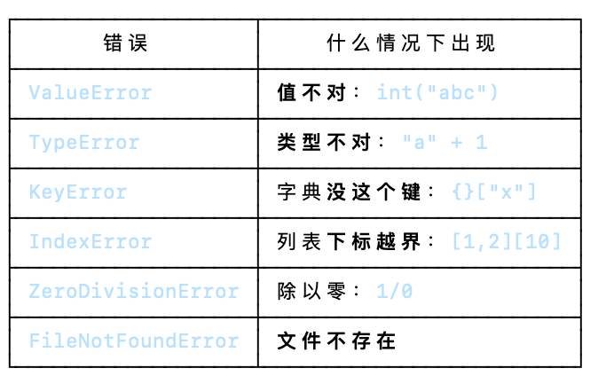

# python3的学习
## 目录
+ []


## 第一章：基础语法
* ### 标识符
1. 第一个字符必须以字母（a-z, A-Z）或下划线 _ 。
2. 标识符的其他的部分由字母、数字和下划线组成。
3. 标识符对大小写敏感，count 和 Count 是不同的标识符。
4. 标识符对长度无硬性限制，但建议保持简洁（一般不超过 20 个字符）
5. 禁止使用保留关键字，如 if、for、class 等不能作为标识符。
   
==eg==. 
```
age = 25                # 普通变量名，最常见
user_name = "Alice"     # 用下划线连接单词，清晰易读
_total = 100            # 下划线开头通常表示“内部使用”或“私有”
MAX_SIZE = 1024         # 全大写通常表示“常量”（固定不变的值）
calculate_area()        # 函数名，动词+名词
StudentInfo             # 类名，首字母大写（驼峰命名法）
__private_var           # 双下划线开头，有特殊含义
```
```
2nd_place = "silver"    # 错误：以数字开头
user-name = "Bob"       # 错误：包含连字符
class = "Math"          # 错误：使用关键字
$price = 9.99          # 错误：包含特殊字符
for = "loop"           # 错误：使用关键字
```
==⚠️==：<u>Python 3 允许使用 Unicode 字符作为标识符，可以用中文作为变量名，非 ASCII 标识符也是允许的了</u>

* ### 保留关键字


[Python 保留关键字参考](https://www.runoob.com/python3/python3-keyword.html)

* ### 注释
1. 单行注释以 # 开头:`print ("Hello, Python!") # 第二个注释`
2. 多行注释可以用多个 # 号，还有 ''' 和 """：
```
第三注释
第四注释
'''
 
"""
第五注释
第六注释
"""
```
* ### 行与缩进
python最具特色的就是使用缩进来表示代码块，不需要使用大括号 {} 。

缩进的空格数是可变的，但是同一个代码块的语句必须包含相同的缩进空格数。空格数不一致，会导致运行错误。==4个空格为一个缩进==

* ### 空行
空行的作用在于分隔两段不同功能或含义的代码，便于日后代码的维护或重构。

* ### print输出
print 默认输出是换行的，如果要实现不换行需要在变量末尾加上 end=" "


* ### import 与 from...import
在 python 用` import `或者 `from...import` 来导入相应的模块[^模块]。

将整个模块(somemodule)导入，格式为： `import somemodule`

从某个模块中导入某个函数,格式为：` from somemodule import somefunction`

从某个模块中导入多个函数,格式为： `from somemodule import firstfunc`, `secondfunc`, `thirdfunc`

将某个模块中的全部函数导入，格式为： `from somemodule import *`

[^模块]: 模块就是一个 `.py` 后缀的 Python 文件，里面写好了变量、函数、类，用来把代码拆分、复用。
一句话：一个`.py`文件 = 一个模块.

* ### 命令行参数
怎么说呢，现在不是很理解这个东西，我对他现在的理解就是我可以从从终端里输入`python3 test.py -n RUNOOB -u www.runoob.com​​​​​`这个东西，然后吧命令参数`RUNOOB`和`www.runoob`交给我的程序`test.py`
对了，命令行参数的内容都被保存在`sys.argv`这个模块中
以后我会回来补充的😘

## 基本数据类型
* Python 中的变量不需要声明。每个变量在使用前都必须赋值，变量赋值以后该变量才会被创建。

在 Python 中，变量就是变量，它没有类型，我们所说的类型是变量所指的内存中对象的类型。

等号 = 用来给变量赋值。等号左边是变量名，右边是存储在变量中的值。
==eg==：
```
#!/usr/bin/python3

counter = 100          # 整型变量
miles   = 1000.0       # 浮点型变量
name    = "runoob"     # 字符串

print(counter)
print(miles)
print(name)
```
* Python 允许你同时为多个变量赋值。
  ==eg==:
  `a = b = c = 1`or`a, b, c = 1, 2, "runoob"`
* 可以通过 `type()` 函数查看变量的类型
  ==like==:
```
print(type(x))         # <class 'int'>
print(type(y))         # <class 'float'>
print(type(name))      # <class 'str'>
print(type(is_active)) # <class 'bool'>
```
### 标准数据类型
Python3 中有 6 种标准数据类型，以及 bool 布尔类型（bool 是 int 的子类，有时单独列出）：

* **Number（数字）**:**int**、**float**、**bool**、**complex（复数）**
**String（字符串）**:Python 中的字符串用单引号 `'` 或双引号 `"` 括起来，同时使用反斜杠 `\` 转义特殊字符。

```
#!/usr/bin/python3

my_str = 'Runoob'       # 定义一个字符串变量（避免使用 str 作为变量名，会覆盖内置类型）

print(my_str)           # 打印整个字符串：Runoob
print(my_str[0:-1])     # 打印索引 0 到倒数第二个字符（不含最后一个）：Runoo
print(my_str[0])        # 打印第一个字符：R
print(my_str[2:5])      # 打印索引 2、3、4 的字符（不含索引 5）：noo
print(my_str[2:])       # 打印从索引 2 开始到末尾：noob
print(my_str * 2)       # 重复打印两次：RunoobRunoob
print(my_str + "TEST")  # 字符串拼接：RunoobTEST
```
***输出***
```
Runoob
Runoo
R
noo
noob
RunoobRunoob
RunoobTEST
```
Python 使用反斜杠 \ 转义特殊字符，如果你不想让反斜杠发生转义，可以在字符串前面添加一个 r，表示原始字符串：
```
>>> print('Ru\noob')
Ru
oob
>>> print(r'Ru\noob')
Ru\noob
```

**bool**（布尔类型）：布尔类型即 True 或 False。在 Python 中，True 和 False 都是关键字，表示布尔值。
**List**（列表）：列表写在方括号 [] 之间，用逗号分隔开的元素列表。
语法格式：变量[头下标:尾下标]


和字符串一样，列表同样可以被索引和截取，列表被截取后返回一个包含所需元素的新列表
**Tuple**（元组）：元组（tuple）与列表类似，不同之处在于元组的元素不能修改。元组写在小括号 () 里，元素之间用逗号隔开。
**Set**（集合）：Python 中的集合（Set）是一种无序、可变的数据类型，用于存储唯一的元素。集合中的元素不会重复，并且可以进行交集、并集、差集等常见的集合操作。

在 Python 中，集合使用大括号 {} 表示，元素之间用逗号 , 分隔。也可以使用 set() 函数创建集合。
==注意==：创建一个空集合必须用 set() 而不是 {}，因为 {} 创建的是一个空字典。


Dictionary（字典）
按是否可变，可以分为以下两类：

不可变数据（4 个）：Number（数字）、String（字符串）、bool（布尔）、Tuple（元组）
可变数据（3 个）：List（列表）、Dictionary（字典）、Set（集合）

bytes 类型表示的是不可变的二进制序列（byte sequence）。与字符串类型不同的是，bytes 类型中的元素是整数值（0 到 255 之间的整数），而不是 Unicode 字符。

**bytes** 类型：
bytes 类型通常用于处理二进制数据，比如图像文件、音频文件、视频文件等。在网络编程中，也经常使用 bytes 类型来传输二进制数据。

创建 bytes 对象最常见的方式是使用 b 前缀：
```
x = b"hello"           # 使用 b 前缀创建 bytes 对象
print(x)               # b'hello'
print(type(x))         # <class 'bytes'>
print(x[0])            # 104（'h' 的 ASCII 值，bytes 元素是整数）
```
### 数据类型的转换
* 隐式类型转换-自动完成：
  对两种不同类型的数据进行运算，较低数据类型（整数）就会转换为较高数据类型（浮点数）以避免数据丢失。但是整型和字符串类型运算结果会报错。
* 显式类型转换-需要使用类型函数来转换
  ==eg==：`y = int(2.8) # y 输出结果为 2`

***
# 头歌实验：
* 补齐空格：`ljust`(左对齐补齐空格)
```
'WHU'.ljust(4)      # 'WHU '   ← 补到 4 个字符宽
'WHUT'.ljust(4)     # 'WHUT'   ← 本来就够 4，原样返回
'PKU'.ljust(4)      # 'PKU '
```
* 必备参数：`def add(a, b):      # ← 你在这里承诺："用我，必须给我两个值"`
* return：return 的作用是"把值送出去"，"结束函数"只是顺带的后果。
* 什么时候真的需要 return

两种情况，一种是送值，一种是提前结束：

① 要把结果交给调用方
```
def add(a, b):
    return a + b       # 调用方要用这个结果

x = add(3, 4)
print(x)               # 7
```
② 要提前溜走，跳过后面的代码

这才是你想的"退出函数"——但注意，只有当后面还有代码需要跳过时，它才有意义：
```
def check(n):
    if n < 0:
        print("负数，不处理")
        return              # ← 提前结束，下面的代码全部跳过
    print("继续处理")
    print("处理完毕")

check(-1)    # 只打印"负数，不处理"
check(5)     # 打印"继续处理"、"处理完毕"
```
对比一下，return 在末尾和在中途的区别：
```
def f():
    print("A")
    return              # 提前溜
    print("B")          # 永远执行不到

f()      # 只打印 A
```
return 写在最后一行 = 废话；写在中间 = 真的在"退出函数"。
* 变量输出：首先，我们先来分清“**格式化**”和"**输出**"：
  - f"..."、"%s" % x、"{}".format(x) → 都是造出一个新字符串，跟 print 没关系
  - print() → 才是把东西显示到屏幕上
  有五种写法：
```
name = "李明"
age = 18

print(name, age)                        # ① print 多参数
print(name + " " + str(age))            # ② 字符串拼接
print("%s %d" % (name, age))            # ③ % 格式化
print("{} {}".format(name, age))        # ④ str.format()
print(f"{name} {age}")                  # ⑤ f-string ← 推荐
```
逐个说：
```

① print 多参数——最简单

print(name, age)              # 李明 18
print("a", "b", "c")          # a b c

逗号分隔，自动加空格。什么都不用管，print 会自动把每个值转成字符串。缺点是格式控制不了（只能空格分隔）。

② + 拼接——类型必须全是字符串

print("你好，" + name + "！")     # 你好，李明！
print("年龄：" + age)             # ✗ TypeError!
print("年龄：" + str(age))        # ✓ 得手动转

+ 对字符串是拼接、对数字是加法，两者不能混。所以数字必须 str() 转一下——很啰嗦，值多了更啰嗦。

③ % 格式化——C 的老朋友

这个你已经会了，就是 C 的 printf：

printf("%s 今年 %d 岁\n", name, age);

print("%s 今年 %d 岁" % (name, age))

常用格式符跟 C 一模一样（我验证过）：

print("%s|%d|%f|%.2f|%5d|%-5d|" % ("abc", 42, 3.14159, 3.14159, 42, 42))
# abc|42|3.141590|3.14|   42|42   |
print("%x  %o  %e" % (255, 8, 1234.5))
# ff  10  1.234500e+03
```
==注意==： 多个值要用元组包起来。 一个值时圆括号可省，两个以上必须加：
```
print("%s" % name)              # ✓ 一个值，可以省
print("%s %d" % (name, age))    # ✓ 两个值，必须加圆括号
print("%s %d" % name, age)      # ✗ 这是陷阱！会报错
```
```
④ str.format()——过渡方案

print("{} {}".format(name, age))                    # 按位置
print("{0} {1} {0}".format("A", "B"))               # 按编号，可以重复用 → A B A
print("{name} 今年 {age} 岁".format(name="李明", age=18))   # 按名字
print("|{:^10}|".format("中"))                       # |    中     |

{} 是占位符。你之前写盒子用的 '{:^22}' 就是它——冒号后面是格式控制（宽度、对齐、精度）。现在见到老朋友了。

⑤ f-string——现在的标准，推荐

字符串前面加个 f，{} 里直接写变量名甚至表达式：

a, b = 8, 9
print(f"{a} + {b} = {a + b}")       # 8 + 9 = 17   ← 表达式直接写在里面
print(f"{name} 明年 {age + 1} 岁")    # 李明 明年 19 岁
print(f"{3.14159:.2f}")             # 3.14
print(f"|{name:>6}|{name:<6}|{name:^6}|")
# |    李明|李明    |  李明  |

额外的调试小技巧（Python 3.8+）：
print(f"{3.14159 * 2 = }")      # 3.14159 * 2 = 6.28318
在 = 号后面加个空格，它会把表达式原文也一起打出来。调试时不用再手写 "a+b=" 这种标签，非常省事。
```
* print:
```
print("a", "b", "c")                    # a b c        默认用空格分隔
print("a", "b", "c", sep="")            # abc          改分隔符
print("a", "b", "c", sep=" -> ")        # a -> b -> c
print("a", end="")                      # 不换行
print("a", end="\n\n")                  # 换两行
```

* 嵌套函数：
  拆解：从里往外读
  
* 亲眼看看 eval 到底有多"万能"
```
print(eval("2 + 3"))              # 5
print(eval("'你好' * 3"))          # 你好你好你好   ← 连字符串运算都行
print(eval("[1, 2, 3][0]"))       # 1             ← 连索引都行
```
普通字符串：一张纸条，上面写着算式，只给你看文字
eval（把字符串当代码执行）：叫 Python读纸条上的内容，直接算出答案，`input()*10        # 这本身就是一段合法的 Python 代码`

* `input`只执行字符串 
* if语法：
  - 冒号 : = 宣告"下面是一个代码块"
  - 缩进 = 标记"这几行属于这个代码块"，缩进的规矩：统一用 4 个空格
* 格式说明符里不能写变量名

关键认识：冒号后面那段是「格式语言」，不是 Python 表达式。

你在里面写 choice，Python 不会去查这个变量的值，而是把它当成格式指令去解析。choice num 不是合法的格式指令 → 报错。


* 「截取」and「四舍五入」

`.4f` 这种写法是四舍五入,字符串切片天生就是"截取"

* 嵌套引号

* ***random模块用法***
导入
```
import random
random.randint(1, 6)              # 每次都要写 random. 前缀

from random import randint, choice
randint(1, 6)                    # 直接叫名字（但容易跟别的名字撞） 
```
常用函数一览


实测效果（我跑出来的真实输出）：
```
random.randint(1, 6)              # 6, 1, 1, 6, 3, 2, 2, 2, 6, 1
random.random()                  # 0.6394, 0.025, 0.275, 0.2232, 0.7365
random.choice(["苹果","香蕉","橘子","葡萄"])   # 苹果
random.choices(..., k=3)         # ['苹果', '香蕉', '苹果']   ← 苹果出现两次
random.sample(..., k=2)          # ['苹果', '橘子']           ← 不会重复
```
==坑点==：
shuffle 原地改，返回 None
```
lst = [1, 2, 3, 4, 5]
lst2 = random.shuffle(lst)      # ✗ lst2 是 None！lst 被改了

lst = [1, 2, 3, 4, 5]
random.shuffle(lst)             # ✓ 直接改 lst 本身
print(lst)                      # [4, 2, 3, 1, 5]
```
seed 有什么用:
```
random.seed(1)
print(random.randint(1, 100))    # 18
random.seed(1)
print(random.randint(1, 100))    # 18  ← 一模一样！
```
不设种子时，Python 拿系统时间当种子，所以每次跑结果都不同。设了种子，同一串随机数就能反复重现。**相当于固定了翻书起点**，数字组合会变，但是产生这个组合的方式不变。
三个实际用途：

1. 调试 —— 程序在某个随机情况下出错，固定种子就能每次都重现那个 bug，否则你根本抓不住
2. 出题/判题 —— 头歌这类平台的"随机"测试数据必须可复现，否则没法判分
3. 做实验 —— 对比两种算法时，要让它们面对同一批随机数据才公平
   
* **字符串，列表，元组，字典**
  
  键（key）和值（value）
{"键": 值} 是JSON 格式，Python 里对应的叫字典 dict，整体是一对一对的映射关系：
 **键（key）**：索引、名字，用来查找
  - 一般是字符串（要用引号包起来），也可以是数字
  - 同一个字典里键不能重复，重复会被覆盖
  - 作用：你通过键去找对应的数据
**值（value）**：真正存的数据
  - 可以是：文字、数字、true/false、数组[]，甚至另一个{}对象
  - 值可以重复，没有限制
  

***第一条分界线（最重要）***：能不能改
不可变：字符串   元组        ← 造出来就冻住了
可变  ：列表     字典        ← 可以增删改
***第二条分界线***：靠什么取元素
靠位置（下标）：字符串  列表  元组     ← 第 0 个、第 1 个……
靠名字（键）  ：字典                   ← d["age"]
1.字符串 str:处理文字、用户输入、文件内容。


2.列表 list:你最常用到的:有序、可变、什么都能装。 就是"C 里那个你得自己 malloc 的动态数组"。
```
scores = [85, 92, 78]

scores.append(90)      # 尾部加一个
scores.insert(0, 100)  # 在指定位置插入
scores[0] = 99         # 改
scores.remove(78)      # 按【值】删
del scores[1]          # 按【下标】删
last = scores.pop()    # 弹出最后一个，并把它返回给你

len(scores)            # 有几个
92 in scores           # 在不在里面
for x in scores:       # 遍历
    print(x)
```
3.元组 tuple——列表的"冻结版":数据天生就不该被改时：

坐标   = (3, 4)
RGB颜色 = (255, 128, 0)
日期   = (2026, 10, 8)
**元组的隐藏技能：解包**
```
name, age = ("张三", 19)      # 一次拆成两个变量
print(name, age)              # 张三 19

a, b = 1, 2
a, b = b, a                   # ★ 交换两个变量，一行搞定！

a, b = b, a 这行，C 里你得这么写：

int tmp = a;
a = b;
b = tmp;          // 三行，还得起个临时变量名
```
顺带：a = 1, 2 其实就是在造元组（括号可以省）。赋值号右边有逗号，就是元组。
4.字典 dict——用"名字"查东西
```
student = {"name": "张三", "age": 19, "city": "武汉"}

student["name"]          # '张三'    ← 用键取，不是下标
student["age"]           # 19
student["score"] = 95    # 加一个新键值对
del student["city"]      # 删
"name" in student        # True     ← 查的是【键】在不在
len(student)             # 有几个键值对

[] 和 get() 的区别（重要）

student["zzz"]              # ✗ KeyError：键不存在直接报错
student.get("zzz")          # None：不存在返回 None，不报错
student.get("zzz", 0)       # 0：不存在就返回你指定的默认值
```
拿不准键在不在时，用 get()。
```
student["zzz"]              # ✗ KeyError：键不存在直接报错
student.get("zzz")          # None：不存在返回 None，不报错
student.get("zzz", 0)       # 0：不存在就返回你指定的默认值
```
**互换**：
```
list("abc")              # ['a', 'b', 'c']     字符串 → 列表
"".join(["a", "b"])      # 'ab'                列表 → 字符串
tuple([1, 2])            # (1, 2)              列表 → 元组
list((1, 2))             # [1, 2]              元组 → 列表
dict([("a", 1)])         # {'a': 1}            键值对列表 → 字典
list(d)                  # ['a', 'c']          字典 → 列表（拿到的是键）
list(d.items())          # [('a', 99), ...]    字典 → 键值对列表
```
* **输入输出列表，元组，字典**
  * 输出
  
  列表
```
lst = [1, 2, 3]

print(lst)                    # [1, 2, 3]        ← 带方括号，一般 OJ 不要这个
print(*lst)                   # 1 2 3            ← ★ 最常用
print(*lst, sep=", ")         # 1, 2, 3          ← 自定义分隔符
print(" ".join(map(str, lst))) # 1 2 3           ← 另一种写法

print(lst) 和 print(*lst) 的区别，是列表输出最关键的一点：

print(lst)   →  [1, 2, 3]     整个列表当一个东西打印，带方括号
print(*lst)  →  1 2 3         把元素一个个拆出来打印

大部分 OJ 题目要的是后者。
```
元组
```
t = (1, 2, 3)
print(t)         # (1, 2, 3)    带圆括号
print(*t)        # 1 2 3        ← 同样用 * 拆开
```
字典（有个坑）
```
d = {"a": 1, "b": 2}

print(d)         # {'a': 1, 'b': 2}    ← 带花括号和引号
print(*d)        # a b                 ← ⚠️ 只拿到【键】，值丢了！

print(*d) 只解出键，因为遍历字典默认就是遍历键。要输出键值对得自己写：

for k, v in d.items():
    print(k, v)              # a 1
                             # b 2

# 或者挤在一行
print(*[f"{k}:{v}" for k, v in d.items()], sep=", ")    # a:1, b:2
```
 ` *`**到底是什么**
你之前学 `*args` 时见过它——* 的作用是"把容器拆开"：
```
print(*[1, 2, 3])        # 完全等于 print(1, 2, 3)
print(*"abc")            # 完全等于 print("a", "b", "c")   → a b c
```
这就解释了为什么它能去掉方括号——因为列表被拆成了三个独立的参数，print 就按"多个参数"来对待了（用 sep 分隔）。

顺带一提，sep 会作用于所有参数之间，包括你写的文字：

`print("前缀", *lst, sep=", ")     # 前缀, 1, 2, 3    ← "前缀"后面也有分隔符`

输入
先背下这一行`nums = list(map(int, input().split()))`
```
input()                →  "1 2 3 4 5"              一整行文本
.split()               →  ["1","2","3","4","5"]    按空格切成列表（但都是字符串！）
map(int, ...)          →   把每个元素都交给 int 转一遍
list(...)              →  [1, 2, 3, 4, 5]          变成真正的整数列表
```

* **集合set（无序、不重复的容器）:**
1. 怎么创建：
 ```
s = {1, 2, 3}                # 花括号
s = set([1, 2, 2, 3, 3])     # 从别的容器造 → {1, 2, 3}
s = set("hello")             # 从字符串造 → {'h','e','l','o'}
s = set()                    # 空集合
```
2. 坑点：
```
type({})        # dict    ← 空字典！
type(set())     # set     ← 空集合只能这么写
```
3. 两个核心特性：
```
① 不重复——自动去重

{1, 2, 2, 3, 3, 3}       # {1, 2, 3}

② 无序——不能下标取值

s = {3, 1, 2}
s[0]        # ✗ TypeError: 'set' object is not subscriptable

所以集合不能"取第几个"，只能判断"在不在"、遍历、做运算。
```
4. 常用操作：
```
s = {1, 2, 3}

s.add(4)          # 加一个
s.remove(1)       # 删一个 —— 不存在会报 KeyError
s.discard(99)     # 删一个 —— 不存在【不报错】（更安全，推荐）

4 in s            # 在不在 → True
len(s)            # 有几个元素

for x in s:       # 可以遍历
    print(x)

remove 和 discard 的区别：不确定元素在不在时，用 discard。
```
5. 集合的运算：
```
a = {1, 2, 3, 4}
b = {3, 4, 5, 6}

a | b      # {1,2,3,4,5,6}   并集：两个合起来
a & b      # {3, 4}          交集：两个都有
a - b      # {1, 2}          差集：a 有但 b 没有
a ^ b      # {1,2,5,6}       对称差：只在一个里有的
```
6. 什么时候用：
```
① 去重（最常用）

lst = [1, 2, 2, 3, 3, 3]
去重后 = list(set(lst))          # [1, 2, 3]

⚠️ 顺序会乱（因为集合无序）。要保持原来的顺序：

保持顺序 = list(dict.fromkeys(lst))    # [1, 2, 3]

（这里借用了字典"键不重复 + 保持插入顺序"的特性。）

② 快速判断"在不在"

集合查元素比列表快得多——列表是"从头一个个比过去"，集合是"算个数字直接跳过去"。数据量大的时候差距是几十上百倍。

③ 求"共同/独有的东西"

就是上面那个选课的例子。
```
  

* **循环语法**
  1.python中的for时遍历而非计数，C里的是计数循环
  
  Python 的 for 后面跟的不是条件，是一个「容器」：
```
for x in [10, 20, 30]:      # 把列表里的元素一个个拿出来，每次叫它 x
for ch in "abc":            # 把字符串的字符一个个拿出来
for k in {"a": 1, "b": 2}:  # 把字典的键一个个拿出来
```

2.如果要计数的话，造一个数字序列去遍历它。
`range()` 不是"计数器"，它造出一串数字让你去遍历：
```
for i in range(10):
    print(i)          # 0 1 2 3 4 5 6 7 8 9

range() 的全部规则（实测）：

list(range(5))          # [0, 1, 2, 3, 4]        从0开始，不含5
list(range(1, 5))       # [1, 2, 3, 4]           含头不含尾
list(range(1, 10, 2))   # [1, 3, 5, 7, 9]        第三个参数是步长
list(range(10, 0, -1))  # [10, 9, ..., 1]        倒着数
list(range(5, 0))       # []                     ⚠️ 空的！
```
`range(5, 0)` 那个坑要记牢：往回数必须写负步长，`range(10, 0, -1)` 才对。忘了写 -1 就得到空序列，for 一次都不执行，程序静悄悄地什么都不干。

▎ 含头不含尾这个规则你已经在切片里见过（s[1:4]）——range 和切片用的是同一套规则，Python 里凡是"范围"都这样。

for 的循环变量是每次都重新赋值的：
```
for i in range(3):
    print(i)
print(i)          # 2   ← 循环结束后 i 还在，值是最后一个
```
（这点和 C 一样。）
3.for 能遍历什么
```
for x in [1, 2, 3]:              # 列表
for ch in "abc":                 # 字符串（一个个字符）
for x in (1, 2, 3):              # 元组
for k in d:                      # 字典 → 拿到【键】
for k, v in d.items():           # 字典 → 同时拿键和值
for line in open("a.txt"):       # 文件 → 一行行读
for i in range(5):               # 数字序列
```
`for _ in range(n)` 里的下划线是惯例："这个变量我用不上，占个位"。你在 OJ 代码里见过很多次了。
4.while（先判断后执行）:什么时候用 while 而不是 for？
▎ - 知道要跑多少次 → for
▎ - 不知道跑多少次，只知道"到某个条件就停" → while
比如"一直读输入直到读到 0 为止"，就该用 while。
5.for...else：Python 特有的
```
for x in [1, 2, 3]:
    if x == 5:
        print("找到了")
        break
else:
    print("循环正常跑完，没被 break 打断")

else 在循环"正常跑完"时执行；如果中途 break 了就不执行。

这个设计专门用来表达**"找遍了都没找到"**：

for student in students:
    if student["name"] == "张三":
        print("找到了")
        break
else:
    print("名单里没有张三")     # ← 一个都没匹配上才走这里
```
6.两个好搭档：enumerate 和 zip
enumerate：既要下标又要值
```
C 的 for 天生带下标 i，Python 的 for 不带——所以需要下标时用 enumerate：

// C：下标是自带的
for (int i = 0; i < n; i++) {
    printf("%d %s\n", i, names[i]);
}

# Python：用 enumerate 把下标也一起拿出来
for i, name in enumerate(names):
    print(i, name)

for i, name in enumerate(["苹果", "香蕉", "橘子"]):
    print(f"{i}: {name}")
# 0: 苹果
# 1: 香蕉
# 2: 橘子

enumerate(names, start=1)      # 想从 1 开始数，加这个参数
```
zip：同时遍历多个序列
```
names = ["张三", "李四", "王五"]
scores = [85, 92, 78]

for n, s in zip(names, scores):
    print(n, s)
# 张三 85
# 李四 92
# 王五 78
```
C 里你得用同一下标 i 去访问两个数组，Python 直接 zip 起来。哪个短就以哪个为准，多出来的忽略。
7.一个必踩的坑：
```
lst = [1, 2, 4, 6, 5]
for x in lst:
    if x % 2 == 0:
        lst.remove(x)
print(lst)      # [1, 4, 5]   ← 4 被跳过了！
```
原因：for 是按位置依次取元素的。你一边删元素，列表一边变短，后面的元素整体往前挪——而 for 的下标还在往前走，于是刚挪过来的那个元素被跳过了。
正确做法：造一个新列表，别改原来的。
```
lst = [1, 2, 4, 6, 5]
lst = [x for x in lst if x % 2 != 0]     # 列表推导式
print(lst)      # [1, 5]
```
▎ 规矩：遍历时不要增删容器元素。 要筛选用"造新列表"，非要原地删就倒着遍历（reversed）或者用 while 手动控制下标。
▎
▎ 注意：改元素的值是安全的（lst[i] = 99 没问题），危险的是增删（改变长度）。
8.列表推导式` [x for x in lst if x % 2 != 0]`:
把满足条件的元素收集成新列表
```
[x * 2 for x in [1, 2, 3]]              # [2, 4, 6]      对每个元素做变换
[x for x in [1, 2, 3, 4] if x % 2 == 0] # [2, 4]         筛选
[x          for x in lst        if x % 2 != 0]
  ↑  取出x    ↑遍历lst中每个元素x   ↑条件：x除以2余数≠0，就是奇数
[x * 2 for x in [1, 2, 3, 4] if x > 1]  # [4, 6]         两者结合
```
相当于`for 循环 + append`
```
result = []
for x in [1, 2, 3]:
    result.append(x * 2)

result = [x * 2 for x in [1, 2, 3]]
```
* Python 规定：所有系统自带的特殊变量 / 方法，都用`__xxx__格`式。这些又叫python里的魔法变量。
  1.` __name__`（你刚学的，最重要）
作用：告诉你当前模块是以什么方式被加载的
直接运行这个文件：`__name__ == "__main__"`
被别的文件import导入：`__name__ == 文件名`
用途：用来写`if __name__ == '__main__':`，分离函数定义 和 测试代码。
函数写上面，测试代码放进 if 里面；导入模块时不会自动跑测试。
2. `__doc__` 文档字符串
就是函数 / 类下面用三引号写的说明文字。
```
python
def cube(length, width, height):
    """计算长方体的表面积和体积"""
    s = (length*width+length*height+width*height)*2
    v = length*width*height
    return s,v

print(cube.__doc__)
输出：计算长方体的表面积和体积
用途：查看函数说明，做文档。
```
3. `__file__`
保存当前 py 文件的路径（在本地电脑有效，在线平台不一定支持）
```
python
print(__file__)
```
4. 类里面的` __init__`（魔法方法，不是变量，但是长得一样）
```
python
class Box:
    def __init__(self,l,w,h):
        self.l = l
```
`__init__`：创建对象的时候自动执行，用来初始化对象属性。
其他常见魔法（后面学习会遇到）
`__str__`：打印对象的时候，控制输出什么文字
`__len__`：调用len(对象)时自动执行
✅ 重点区分：魔法变量 vs 普通变量
普通变量：存业务数据，比如长宽、面积、a=3
魔法变量：存代码本身的信息（文件名字、模块信息、文档说明），描述代码自身。
⚠️ 重要提醒
不要自己随便创建 `__xxx__ `名字，属于系统预留，容易冲突。自己写变量只用普通名字，比如length、volume。
魔法变量不用你手动赋值，Python 自动帮你生成。你只负责读取。
简单总结
普通变量 = 存计算的数据（长宽、面积）
`__xxx__`魔法变量 = 存代码自己的信息（文件、模块、文档）
"魔法"的意思是不用动手调用，python在特定时机自动调用他 
* **try/except：**
解决的是一个很实际的问题：程别一出就死掉。
1. 先看没有它会怎样：
```
age = int(input("你的年龄："))
print("继续执行")

用户输入 abc：

ValueError: invalid literal for int() with base 10: 'abc'
```
 程序当场死了，`print `那行一行都不执行。 用户看到一堆红色报错，什么也干不了。
 2. 基本语法：
```
try:
    可能出错的代码
except 错误类型:
    出错之后怎么办

try:
    age = int(input("你的年龄："))
    print(f"你今年 {age} 岁")
except ValueError:
    print("输入的不是整数")
```
流程：Python 去跑 try 里的代码 → 一切正常就走完了；中途出错 → 立刻跳到 except，try 里剩下的代码不执行。
3. 完整结构：
```
try:
    n = int(input("数字："))
except ValueError:
    print("不是数字")
else:
    print("成功了，n =", n)       # 没出错才执行
finally:
    print("无论如何都执行")        # 出事没出事都执行

┌─────────┬────────────────────┐
│   块    │    什么时候执行    │
├─────────┼────────────────────┤
│ try     │ 总是（要试的代码） │
├─────────┼────────────────────┤
│ except  │ 出错时             │
├─────────┼────────────────────┤
│ else    │ 没出错时           │
├─────────┼────────────────────┤
│ finally │ 无论如何都执行     │
└─────────┴────────────────────┘

平时只用 try + except 就够了，else 和 finally 知道有这么回事即可。
```
4. 常用的错误类型：

5. 三条规矩：
```
① 别写光秃秃的 except:

try:
    ...
except:              # ✗ 什么都抓，连你自己的拼写错误都吞掉
    pass

这是最坏的习惯。 它会把真实 bug 藏起来——程序看起来在跑，实际上什么都没干，你查半天查不出来。

至少写成 except Exception:，它不会抓走 Ctrl+C（KeyboardInterrupt），比裸 except: 安全。

② 尽量指明具体类型

except ValueError:       # ✓ 只抓这一类
except Exception:        # 次选
except:                  # ✗ 别这么写

③ except 里别只写 pass

except ValueError:
    pass                 # ✗ 出错了但你什么都不说

至少告诉用户出错了。pass 只用在"我确实要故意忽略"的少见场合。
```
6. 经典用法：
```
这是你最常用到的模式，背下来：

while True:
    try:
        age = int(input("请输入年龄："))
        break                    # 成功了才跳出循环
    except ValueError:
        print("你输入的不是整数，请重试")
```
流程：一直问 → 用户输入合法数字就 break 出去 → 不合法就提示重试。

这解决了你之前反复踩的那个坑：用户输入乱七八糟的东西，程序不再崩溃。
7. 什么时候该用、什么时候不该用:
- 用户输入（上面那个）
- 读文件（文件可能不存在）
- 网络请求（可能超时）
- 格式转换（数据可能不合预期）

❌ 不该用来掩盖自己的 bug

try:
    复杂的一段逻辑
except Exception:
    print("出错了")

这种写法很危险：它把你代码里的真实错误也一起吞了。你写错的变量名、用错的方法，全都会被伪装成"出错了"，然后你永远查不出来。

判断标准一句话：

▎ try/except 是给"我控制不了的意外"用的，不是给"我没写对"用的。
* **切字符：**
1. 按分隔符切：split（）最常用
```
s = "a,b,c,123"
res = s.split(",")  # 用逗号切开，返回列表
print(res)
# ['a', 'b', 'c', '123']
split() 不带参数：按任意空白（空格 / 换行 /tab）切割，自动忽略连续空格
```
split(sep,maxsplit)限制切几次
```
s = "one two three four"
print(s.split(" ", maxsplit=2)) # 只切前2次：['one', 'two', 'three four']
```
2. 从右切：rsplit():
```
s = "one two three four"
print(s.split(" ", maxsplit=2)) # 只切前2次：['one', 'two', 'three four']
```
3. 按行切splitlines()：
把多行字符串按换行\n切开
```
txt = "第一行\n第二行\n第三行"
print(txt.splitlines())
```
4. 切片截取（按位置去一段字符，不是分割成列表）：
格式：字符串[起始：结束：步长]：左开右闭，结束下标不取
```
s = "abcdef"
print(s[1:4])  # 下标1到3：bcd
print(s[:3])   # 从头到下标2：abc
print(s[2:])   # 下标2到末尾：cdef
print(s[::2])  # 步长2，隔一个取一个：ace
print(s[::-1]) # 字符串反转：fedcba
```
5. 取单个字符下标：
```
s = "abcdef"
print(s[1:4])  # 下标1到3：bcd
print(s[:3])   # 从头到下标2：abc
print(s[2:])   # 下标2到末尾：cdef
print(s[::2])  # 步长2，隔一个取一个：ace
print(s[::-1]) # 字符串反转：fedcba
```
6. 区分：split：按符号切成多个字符串，得到列表（拆分句子）
[a:b]：按位置截取一段子串（抠一段文字）
* `from math import *`:*代表全部东西,直接写 pi、sin、log！
* 第 1 个 if 成立，打印沪市 A 股
后面所有 if 都不成立，最后一个 if 不成立，触发它的 else，额外打印：错误编码
👉 结果会输出两行
