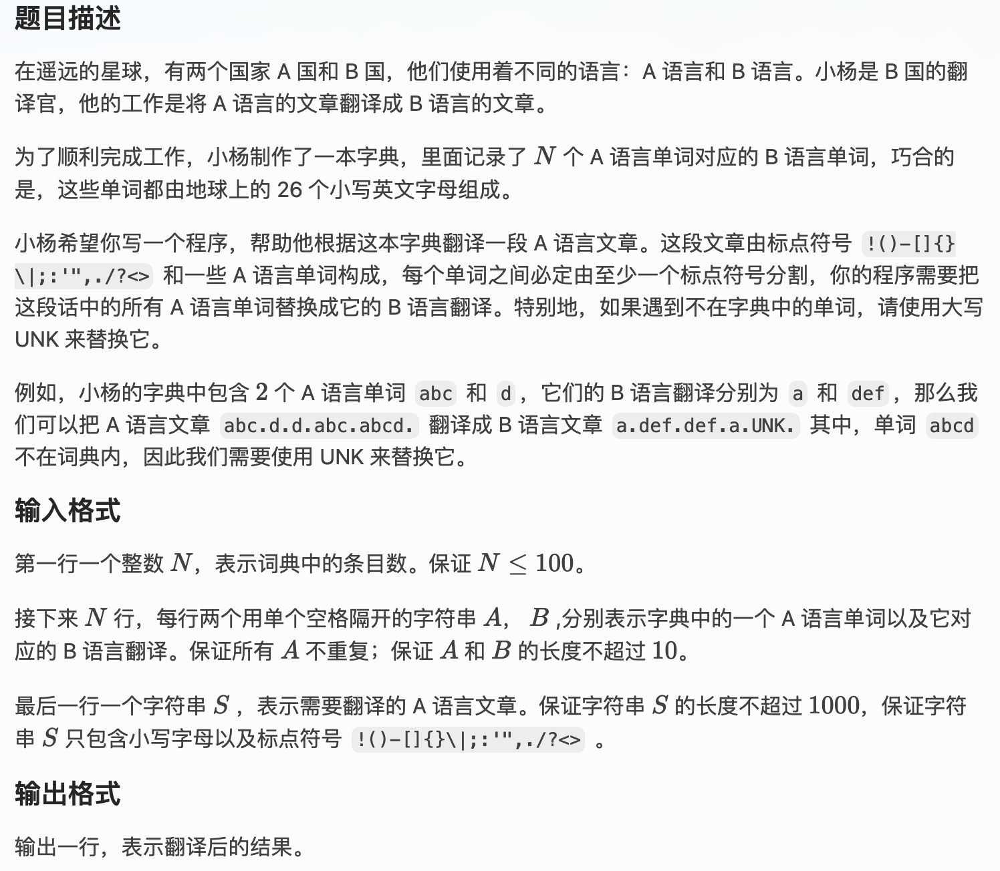
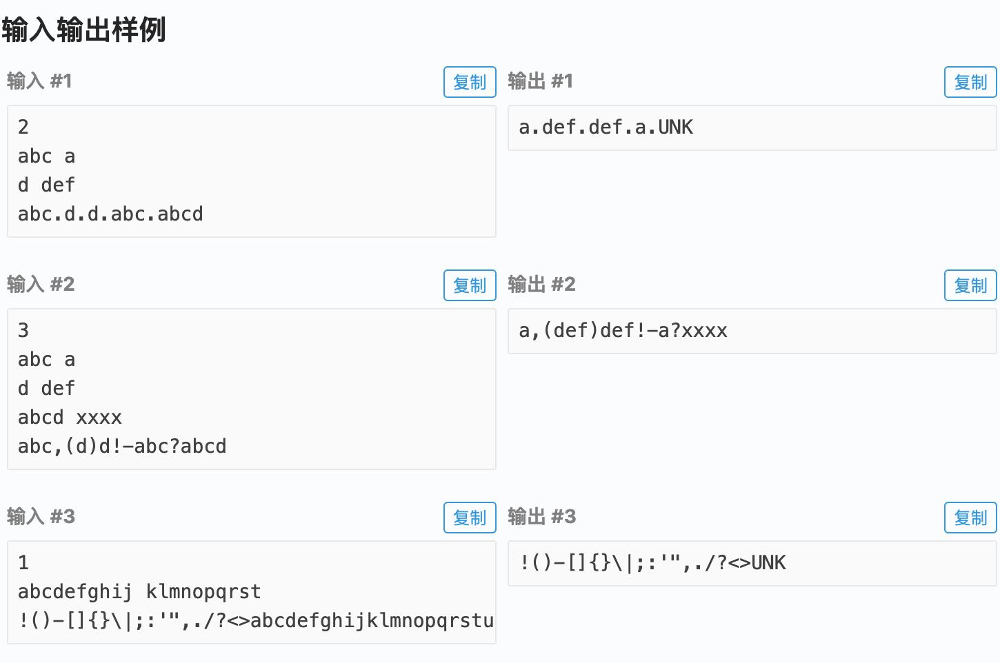
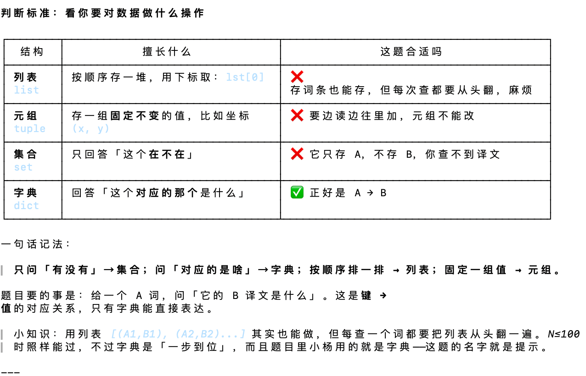
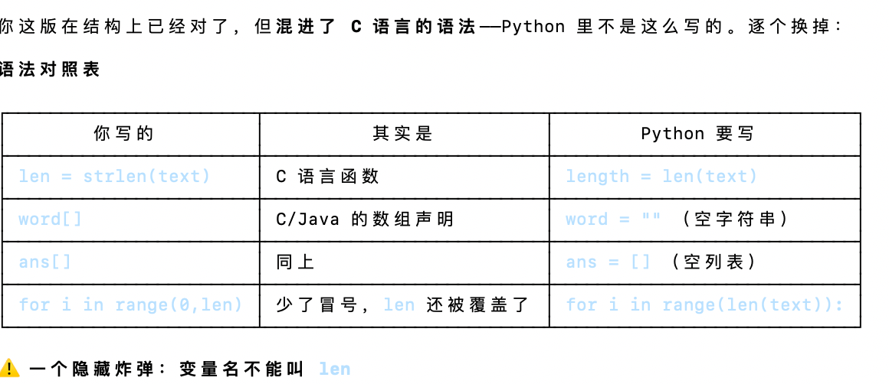
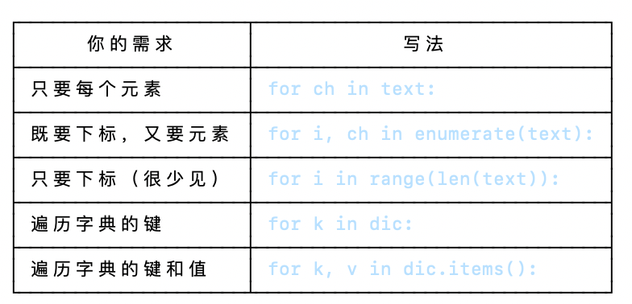

# "Comment-Driven Development"（注释驱动开发）
## methods(4 steps):
**1. 读题，圈出**    输入什么？输出什么？有哪些规则？
**2. 拆解**         把大问题拆成 5~8 个小步骤，每步一句话
**3. 写注释**       把小步骤逐条写成注释
**4.逐条实现**      对着每条注释写代码，写完一条划掉一条
关键在第 ② 步：拆到「一句话就能说清」的程度。如果某一步你想写成两句，说明它还能再拆。
## demonstrate:


① 读题：圈出关键信息

读的时候拿笔（或在纸上）列出来：

输入
- 第 1 行：N（字典有几个词）
- 接下来 N 行：每行 A B —— A 语言词 → B 语言词
- 最后 1 行：文章 S

输出
- 翻译后的文章（一行）

规则
- 文章里的单词 → 查字典替换
- 字典里没有的单词 → 换成 UNK
- 标点 → 原样保留

② 拆解 —— 这一步最关键

大问题：「把 S 翻译一遍」

你不能一上来就想「怎么翻译」，要先问：S 是一整串字符，我怎么知道哪几个字符是一个单词？

这就是这道题的核心难点。拆解如下：

1. 先把字典建好        ← 不然没法查
2. 一个字符一个字符地看 S
3. 遇到字母 → 攒起来    ← 因为一个单词有好几个字母
4. 遇到标点 → 说明一个单词结束了
        → 先把攒的单词翻译掉
        → 再输出这个标点
5. 文章遍历完 → 别忘了最后可能还剩一个单词没处理

第 5 步是最容易漏的。 你在写注释的时候就能想到它，但要是直接写代码，八成会漏，然后样例 3 过不了。

③ 把上面的拆解写成注释
```
# 1. 读入 N
# 2. 读入 N 行，建立字典：A语言单词 -> B语言单词
# 3. 读入文章 S
# 4. 准备一个列表 result，存翻译后的结果
# 5. 准备一个字符串 word = ""，存"当前正在读的单词"
# 6. 遍历 S 的每一个字符 c：
#      如果 c 是小写字母：
#          把 c 拼到 word 后面
#      否则（说明 c 是标点）：
#          如果 word 不为空：
#              去字典里查 word
#              查到就用翻译，查不到就用 "UNK"
#              把结果加进 result
#              清空 word（准备读下一个单词）
#          把标点 c 加进 result
# 7. 循环结束后，如果 word 还不为空（说明文章是单词结尾）：
#      翻译它，加进 result
# 8. 把 result 拼成一整行，输出
```
这份注释就是你的「施工图」。 下一步只是把它翻译成 Python 而已。


* **我自己写的**
```
#读入数据
#读入整数
n = int(input())
#读入n行条目数，建立字典
dic = {}
for i in range(0,n):
    pass
    a,b=input().split()
    dic(a) = b
    
#输入文本
text = input()
lenth = len(text)
#扫描文章，在有符号处出要断开
#攒字母
word = "" 
#攒答案
ans = []
#遍历text
for ch in text:
    pass
    if 'a'<=ch<='z':
        word +=ch
    else:
        if word:
            ans.append(dic.get(word,"UNK"))
            word = ""
            ans.append(ch)
if word:
    ans.append(dic.get(word,"UNK"))
#输出
print(''.join(ans))
```
## 学到的
* 字典的小语法：
```
  # 1. 建一个空字典
phone = {}

# 2. 往里面加一条：键 → 值
phone["小明"] = "138xxxx"

# 3. 查：给键，取值
print(phone["小明"])        # 138xxxx

就三个动作：建空的 → 字典[键] = 值 → 字典[键]。
```
* pass的作用：占行用的
* 
* a, b = input().split()：
 ```
 拆成三行

line  = input()        # ① 读一行
parts = line.split()   # ② 按空格切开
a, b  = parts          # ③ 分别装进两个变量

① input() 读一整行

line = input()

你输入 abc a，line 就是一个完整的字符串 "abc a"（中间那个空格也是字符串的一部分）。程序还不知道这是两个词。

② .split() 按空格切

parts = "abc a".split()

split 把字符串按空白切开，返回一个列表：

parts = ["abc", "a"]

③ a, b = [...] 拆包

a, b = ["abc", "a"]

这叫解包（unpacking）：把列表里的元素按顺序分给左边的变量。

a   # "abc"
b   # "a"

所以合起来就是

a, b = input().split()

读一行 → 按空格切成两个 → 分别赋给 a 和 b。题目保证每行正好是「A 空格 B」，所以拆出来一定是两个。
 ``` 
* 解包：
```
1. 普通解包（数量刚好对上）— 不用 *

a, b = [1, 2]          # a=1, b=2
a, b = "abc a".split() # a="abc", b="a"

左边几个变量，右边就得几个元素，一一对应。这题就是这种，所以不需要星号。

2. 星号解包（数量对不上）— 用 *

* 的意思是：「剩下的全归我，打包成列表」

first, *rest = [1, 2, 3, 4]
# first = 1
# rest  = [2, 3, 4]

*head, last = [1, 2, 3, 4]
# head = [1, 2, 3]
# last = 4

a, *middle, z = [1, 2, 3, 4, 5]
# a = 1, middle = [2, 3, 4], z = 5

规则：

- 一个赋值语句里最多只能有一个 *，否则 SyntaxError
- 带 * 的变量拿到的永远是一个列表（哪怕只剩一个元素，也是 [x]）
- 不带 * 的变量还是按位置对应

3. * 的其他常见用途（同一个"摊开"的意思）

函数调用时摊开列表：

nums = [1, 2, 3]
print(*nums)        # 等价于 print(1, 2, 3)，输出 "1 2 3"

函数定义时收集参数：

def add(*args):     # args 是一 数
    return sum(args)

add(1, 2, 3)        # args = (1, 2, 3)

合并列表：

a = [1, 2]
b = [3, 4]
c = [*a, *b]        # [1, 2, 3, 4]

字典合并（用两个星号）：

d1 = {"a": 1}
d2 = {"b": 2}
d3 = {**d1, **d2}   # {"a": 1, "b": 2}

4. 回到这题

a, b = input().split()

split() 拆出来正好两个元素，左边也正好两个变量，一一对应，不需要 *。

如果哪天你只想要第一个词、剩下的不管，才写成这样：

a, *others = input().split()
```
* python中有更直接方便的便利方式：for 后面跟的可以是任何能逐个取元素的东西——字符串、列表、元组、字典、文件，甚至 range() 产生的数字序列。range(len(text)) 只是其中一种，而且是最不 Python 的一种。

* Python 里 if 后面不一定非要写比较式，任何值都能直接判断「真/假」：
```
if word:

等价于：

if word != "":        # word 不是空字符串
if len(word) > 0:     # word 长度大于 0
```
* **ans.append(dic.get(word, "UNK"))**
函数 vs 方法
```
你之前用的这些叫函数（function）——直接写名字就能调用：

print(...)      # 内置函数
input()         # 内置函数
len(text)       # 内置函数
int(...)        # 内置函数

下面这些叫方法（method）——它们"长"在某个对象身上，要用点号 . 去调用：

text.split()     # 字符串 text 自带的方法
dic.get(...)     # 字典 dic 自带的方法
ans.append(...)  # 列表 ans 自带的方法
word.lower()     # 字符串自带的方法

点号的意思是"调用这个对象自带的功能"。dic.get(...) 读作：「让字典 dic 执行它自己的 get 动作」。
```
* 查方法：
```
方式一：Python 交互环境（最直接）

在终端输入 python3 回车，进入交互模式（提示符变成 >>>）：

$ python3
>>> dic = {}
>>> dir(dic)
['__class__', '__contains__', ..., 'clear', 'copy', 'get', 'items', 'keys', ...]
>>> help(dic.get)
Help on built-in function get:

get(key, default=None, /) method of builtins.dict instance
    Return the value for key if key is in the dictionary, else default.
>>> quit()

dir(dic) 的真实输出（我过滤掉了 __ 开头的）：

['clear', 'copy', 'fromkeys', 'get', 'items', 'keys', 'pop', 'popitem', 'setdefault', 'update', 'values']

- __ 开头的是 Python 内部用的特殊方法，初学阶段直接忽略
- 名字就是一目了然的缩写：get 查、keys 所有键、values 所有值、items 键值对、update 更新

help(dic.get) 的说明书长这样：

get(key, default=None, /) method of builtins.dict instance
    Return the value for key if key is in the dictionary, else default.
```
**不太重要了解即可**
* `''.join(ans)`
  '' —— 一个空字符串，它在这里的角色是分隔符
  .join(ans) —— 字符串自带的方法，意思是「用我这个字符串，把 ans 里的元素一个个连起来」
```
  假设前面扫描完，ans 是这样的：

ans = ['a', '.', 'def', '.', 'def', '.', 'a', '.', 'UNK']

那么：

''.join(ans)      # 'a.def.def.a.UNK'   ← 空字符串当分隔符 = 直接贴在一起

换不同的分隔符试试：

'-'.join(['a', 'b', 'c'])    # 'a-b-c'
' '.join(['a', 'b', 'c'])    # 'a b c'
','.join(['a', 'b', 'c'])    # 'a,b,c'
''.join(['a', 'b', 'c'])     # 'abc'

规律：分隔符会插在每两个元素之间。

为什么不直接 print(ans)

ans = ['a', '.', 'def']
print(ans)          # ['a', '.', 'def']    ← 带方括号和引号，这是列表的显示格式
print(''.join(ans)) # a.def               ← 这才是文章的样子

print 一个列表，打印的是 Python 的数据结构表示，不是你想要的文章。
```
为什么写成 `''.join(ans) `而不是` ans.join('')`
因为 join 是「字符串」的方法，不是「列表」的方法
'分隔符'.join(列表)     # ✅ 正确：字符串在前面
列表.join('分隔符')     # ❌ 报错：列表没有 join 方法